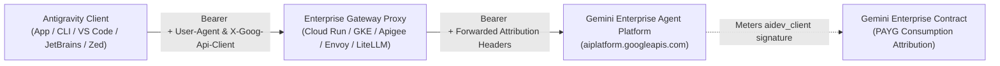
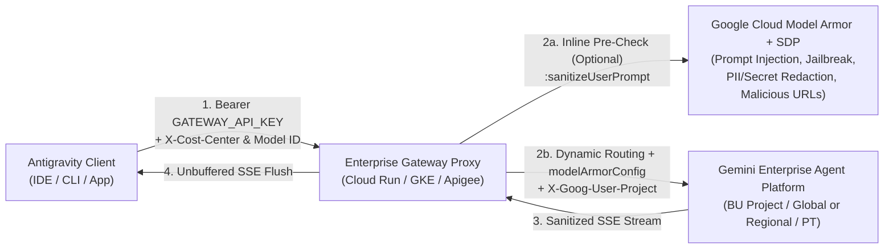

<!--
Purpose: Comprehensive deployment, configuration, governance, and reference implementation guide for the Antigravity Enterprise Gateway reverse proxy.
Architecture/Context: Combines the official public Google Cloud Gemini Enterprise documentation (deploy-enterprise-gateway and connect-enterprise-gateway) and Enterprise Preview v2.0 operational guidance with the turnkey Python 3.12 and Go 1.24 implementations in ./enterprise-gateway/, ./vm-provisioning/, and ./agy-config/.
Dependencies/Side Effects: Requires Google Cloud Gemini Enterprise Agent Platform API (aiplatform.googleapis.com), Secret Manager API (secretmanager.googleapis.com), optional Model Armor & Cloud SDP APIs (modelarmor.googleapis.com, dlp.googleapis.com), and roles/aiplatform.user.
-->

# Antigravity Enterprise Gateway: Quickstart Guide & Official Documentation

> [!WARNING]
> **Disclaimer — Reference & Test Implementation (No Warranty):**
> This repository and guide are provided strictly as a reference implementation for testing and evaluation, **"AS IS" without warranty of any kind**. Use at your own risk, never hardcode credentials or API keys in source control, and review all IAM, network ingress, and workstation MDM policies with your organization's security team before production rollout.

**Official Documentation & Repository Module Links:**
* **Admin Deployment Guide:** [Configure an enterprise gateway for Google Antigravity](https://docs.cloud.google.com/gemini/enterprise/docs/ai-developer-tools/deploy-enterprise-gateway?hl=en)
* **Developer Connection Guide:** [Connect Antigravity to an Enterprise Gateway](https://docs.cloud.google.com/gemini/enterprise/docs/ai-developer-tools/connect-enterprise-gateway?hl=en)
* **Runnable Modules in This Repository:**
  * [`./enterprise-gateway/`](./enterprise-gateway/README.md) — Production-ready **Python 3.12 (`FastAPI`)** and **Go 1.24** gateway servers, **Model Armor + Cloud SDP** declarative templates, GKE manifests, and unified Cloud Run installer (`install.sh` / `uninstall.sh`).
  * [`./vm-provisioning/`](./vm-provisioning/README.md) — Automated Linux (`Ubuntu 22.04`) and Windows (`Windows Server 2022`) GCE developer workstation provisioning.
  * [`./agy-config/`](./agy-config/README.md) — 8 self-documented Antigravity client, sandbox, MCP, hook, and MDM configuration modules with OS kernel immutability scripts (`chattr +i`, `chflags schg`, `icacls /deny`).
* **Audience:** Platform Engineers, Security Architects, Network Administrators, and Enterprise Developers

---

## Overview & Architecture

Enterprise organizations in regulated industries often maintain strict network controls that prevent developer workstations from making direct internet connections to external services or completing interactive browser-based Google sign-in.

**Antigravity Enterprise Gateway** lets you route Antigravity traffic through an enterprise gateway that your organization operates before forwarding inference requests to Google (**Gemini Enterprise Agent Platform**, formerly Vertex AI). This architecture routes model inference requests through your gateway, supports centralized data-loss prevention and multi-provider routing, and removes interactive sign-in while preserving your **Gemini Enterprise contract billing attribution**.



> [!IMPORTANT]
> **Billing & Quota Model (PAYG vs. Seat Quotas):**
> * Antigravity Enterprise Gateway routes inference requests using a centralized Google Cloud service account and is billed on a **pay-as-you-go (PAYG) consumption basis** through the **Gemini Enterprise Agent Platform** under your organization's Gemini Enterprise agreement.
> * This deployment model **does not use your Gemini Enterprise seat-based subscription quotas** (such as included Standard or Plus monthly allowances).
> * Deploying the enterprise gateway does **not** require an invoiced Cloud Billing account—any organization with access to Gemini Enterprise Agent Platform can deploy it.
> * You **cannot** use a gateway and sign in with a Google Account at the same time. If you want to use your included seat-based subscription quota instead, disable the enterprise gateway and sign in interactively with your Google Account.

---

## Supported Tools & Minimum Versions

Antigravity Enterprise Gateway supports the following AI developer tools:

| Tool | Minimum Version | Supported Platforms |
| :--- | :--- | :--- |
| **Antigravity app** | `2.15.0` or later | macOS (Apple silicon `arm64`, Intel `x86_64`), Windows 10/11 (64-bit), Linux (`x86_64`) |
| **Antigravity CLI (`agy`)** | `1.2.15` or later | macOS (`arm64`), Linux (`x86_64`), Windows (`x86_64`) |
| **Antigravity for IDEs** | • **VS Code & Visual Studio:** Antigravity CLI `1.2.15` or later (auto-downloaded by the extension)<br>• **JetBrains IDEs & Zed (with ACP server):** `1.3.0` or later | Visual Studio Code, Visual Studio, JetBrains IDEs, and Zed. See [Antigravity IDE extensions](https://antigravity.google/docs/ide/extensions). |

> [!NOTE]
> **Web Limitation:** Antigravity on the web does not support enterprise gateway routing and requires interactive Google sign-in. To use gateway authentication, use the Antigravity app, CLI (`agy`), or supported IDE extensions.

---

## Before You Begin

Before deploying the gateway, verify that you have the following:

1. **Google Cloud Project:** A Google Cloud project with access to **Gemini Enterprise Agent Platform** (formerly Vertex AI) and the `aiplatform.googleapis.com` API enabled.
2. **Service Account:** A Google Cloud service account in your project granted the `roles/aiplatform.user` IAM role (plus `roles/modelarmor.user` and `roles/dlp.user` if enabling inline Model Armor + Cloud SDP screening). Your gateway uses this service account to authenticate Antigravity requests to Google Cloud.
3. **Data Access Audit Logs:** To verify billing attribution in Cloud Logging, turn on **Data Read** and **Data Write** Data Access audit logs for the Gemini Enterprise Agent Platform API (`aiplatform.googleapis.com`) under **IAM & Admin $\rightarrow$ Audit Logs**.
4. **Supported Client Versions:** Developers must use the minimum supported versions listed in the table above.

---

## Step 1: Gateway Proxy Integration & Infrastructure Contracts

You can host your enterprise gateway using any containerized or managed platform, such as **Google Cloud Run**, **Google Kubernetes Engine (GKE)**, **Apigee**, **Envoy**, **Portkey**, or **LiteLLM**.

> [!TIP]
> **Turnkey Python & Go Cloud Run / GKE Deployments:**
> * For complete, symmetric 7-block **Python 3.12 (`FastAPI`)** and **Go 1.24** implementations with automated installers, see [`./enterprise-gateway/`](./enterprise-gateway/README.md).
> * For a self-contained Go reference walkthrough right in this document, see [Reference Implementation: Enterprise Gateway on Google Cloud Run](#reference-implementation-enterprise-gateway-on-google-cloud-run) below.

### 1. Three Core Proxy Responsibilities

Your reverse proxy must implement three core infrastructure responsibilities:

1. **Preserve Client Attribution Headers:** Forward incoming client headers unchanged to Google, including `User-Agent`, `X-Goog-Api-Client`, and any custom headers configured in `gateway.customHeaders` (such as `X-Cost-Center` or `X-Corporate-BU`).
   * *Cross-Project Quota/Billing Note:* Antigravity clients don't send Google Cloud project information in gateway mode. If your gateway forwards requests to a project other than the project containing the gateway's service account, configure your gateway to inject the `X-Goog-User-Project` header with the target project ID.
2. **Support Unbuffered Streaming:** Flush Server-Sent Events (`text/event-stream`) chunks immediately when processing streaming requests (`:streamGenerateContent?alt=sse` or OpenAI `"stream": true`). Do not buffer chunks in the gateway layer, and allow requests to run for up to **60 minutes** (`--timeout=3600` on Cloud Run) so long multi-step agentic workflows aren't prematurely terminated.
3. **Acknowledge Telemetry Endpoints:** Respond with HTTP `200 OK` (`{}`) to background metric calls (`POST /v1beta:*` and `POST /v1internal:*`), and optionally emit structured JSON logs (`LOG_TELEMETRY_PAYLOADS="true"`) for asynchronous ingestion into BigQuery, Splunk, or Datadog.

#### A. Header Preservation & Billing Attribution (Critical)

Antigravity automatically attaches client attribution headers to identify developer chat prompts and agent workflows. To ensure usage is recognized and billed under your organization's existing **Gemini Enterprise agreement** rather than uncommitted raw API consumption, your gateway must preserve and forward these headers:

| Header | Required? | Description & Attribution Impact |
| :--- | :---: | :--- |
| `User-Agent` | **Yes** | Emitted as `antigravity/<VERSION> (aidev_client; auth_method=gateway)`. Google meters and attributes usage to your Gemini Enterprise contract using this signature. Stripping it defaults usage to unallocated raw API consumption. |
| `X-Goog-Api-Client` | **Yes** | Identifies the Antigravity client runtime and SDK telemetry (`gl-go/1.24 antigravity/...`) so Google credits the activity to your licensed enterprise deployment. |
| `X-Goog-User-Project` | Optional | Injected by the gateway (or client) when the target billing/quota project differs from the project containing the gateway's service account. |
| `X-Cost-Center` / `X-Corporate-BU` / `X-Enterprise-*` | Optional | Custom audit and chargeback tags injected by client MDM configuration (`gateway.customHeaders` in `admin_settings.json`). Pin these in Tier-1 `admin_settings.json` so developers cannot spoof chargeback headers in `~/.antigravity/settings.json`. |

```go
// 1. Forward User-Agent unchanged for Gemini Enterprise contract attribution
if ua := req.Header.Get("User-Agent"); ua != "" {
	outReq.Header.Set("User-Agent", ua)
}

// 2. Propagate telemetry and custom chargeback headers (X-Goog-Api-Client, X-Cost-Center, etc.)
for k, v := range req.Header {
	if strings.HasPrefix(strings.ToLower(k), "x-") {
		for _, val := range v {
			outReq.Header.Add(k, val)
		}
	}
}
```

#### B. Server-Sent Events (SSE) Unbuffered Streaming Flush

Streaming responses (`:streamGenerateContent?alt=sse` and OpenAI `"stream": true`) must be flushed to the client immediately without intermediate proxy buffering:

```go
// Stream response chunks immediately (4 KiB buffer + http.Flusher) to prevent client token timeouts
flusher, ok := w.(http.Flusher)
buf := make([]byte, 4096)
for {
	n, err := resp.Body.Read(buf)
	if n > 0 {
		_, _ = w.Write(buf[:n])
		if ok {
			flusher.Flush()
		}
	}
	if err != nil {
		break
	}
}
```

#### C. Telemetry & Internal Endpoints (`/v1beta:*` & `/v1internal:*`)

Antigravity clients periodically emit background telemetry to `/v1beta:` and `/v1internal:` endpoints (`recordCodeAssistMetrics`, `registerInteraction`, `recordInteraction`). Because these paths do not exist on `aiplatform.googleapis.com`, forwarding them upstream causes `404` retry noise. Short-circuit both prefixes with `200 OK` (`{}`):

```go
// Acknowledge background metrics immediately (and optionally emit structured JSON to stdout for SIEM sinks)
if strings.HasPrefix(req.URL.Path, "/v1internal:") || strings.HasPrefix(req.URL.Path, "/v1beta:") {
	w.Header().Set("Content-Type", "application/json")
	w.WriteHeader(http.StatusOK)
	_, _ = w.Write([]byte("{}"))
	return
}
```

---

### 2. Mandatory Request Paths & Supported Wire Protocols

#### Mandatory Inference Paths (`genai` Protocol)

Paths are relative to your gateway URL (e.g., `https://gateway.cymbal.com/v1beta/models/MODEL_ID:streamGenerateContent?alt=sse`). Your gateway must accept and route both simplified paths and full Gemini Enterprise Agent Platform paths:

* **Simplified Paths:**
  * **Streaming inference:** `POST /v1beta/models/{MODEL_ID}:streamGenerateContent?alt=sse`
  * **Unary inference:** `POST /v1beta/models/{MODEL_ID}:generateContent`
* **Full Gemini Enterprise Agent Platform Paths:**
  * **Streaming inference:** `POST /v1beta1/projects/{PROJECT_ID}/locations/{REGION}/publishers/google/models/{MODEL_ID}:streamGenerateContent?alt=sse`
  * **Unary inference:** `POST /v1beta1/projects/{PROJECT_ID}/locations/{REGION}/publishers/google/models/{MODEL_ID}:generateContent`

Request bodies use the standard `generateContent` JSON schema (`contents`, `generationConfig`, `safetySettings`, `tools`, and `systemInstruction`).

#### Supported Wire Protocols (`genai` vs. `openai`)

Antigravity Enterprise Gateway supports two wire protocols for inference requests:

1. **Gemini Protocol (`genai` — Default & Recommended):** Antigravity sends inference requests formatted in Google's native `generateContent` schema to the `POST /v1beta/models/...` endpoints above, preserving native multimodal parts, Gemini thinking controls, and native `modelArmorConfig` support.
2. **OpenAI Wire Protocol (`openai`):** When you set `gateway.wireProtocol` to `"openai"` in `admin_settings.json` (or `AGY_LLM_GATEWAY_WIRE_PROTOCOL="openai"`), Antigravity formats inference requests in the OpenAI Chat Completions schema (`messages[]`, `model`, `stream`) and sends them to `POST /v1/chat/completions`.
   * **Vertex AI OpenAI Upstream (Default):** Both the Go and Python gateways in [`./enterprise-gateway/`](./enterprise-gateway/README.md) automatically normalize `"model": "<MODEL_ID>"` to `"google/<MODEL_ID>"` and route `POST /v1/chat/completions` to Vertex AI's OpenAI-compatible endpoint:
     ```text
     POST https://{REGION}-aiplatform.googleapis.com/v1beta1/projects/{PROJECT_ID}/locations/{REGION}/endpoints/openapi/chat/completions
     ```
     *(or `https://aiplatform.googleapis.com/v1beta1/projects/{PROJECT_ID}/locations/global/endpoints/openapi/chat/completions` for `global` models).*
   * **Multi-Provider / Custom Upstream (`OPENAI_UPSTREAM_BASE_URL`):** Set `OPENAI_UPSTREAM_BASE_URL` on the gateway to forward `POST /v1/chat/completions` to an internal **LiteLLM**, **Portkey**, **vLLM**, or **Apigee** router while still enforcing gateway auth and inline Model Armor / Cloud SDP screening on `messages[]`.

> [!NOTE]
> **ACP Server Limitation (JetBrains & Zed):** The Antigravity ACP server (used by JetBrains IDEs and Zed) supports **only** the `genai` wire protocol. If `admin_settings.json` configures `"wireProtocol": "openai"`, JetBrains and Zed sessions fail to connect with the error: `gateway.wireProtocol 'openai' is not supported by the ACP server`.

---

### 3. Authentication, Multi-Key Rotation & Private Network Ingress

Antigravity authenticates to your gateway with an API key that your gateway issues (`gateway.apiKey` or `AGY_LLM_GATEWAY_API_KEY`), sent as:

```http
Authorization: Bearer GATEWAY_API_KEY
```

* **Constant-Time Verification & Zero-Downtime Key Rotation:** Validate incoming bearer tokens with `crypto/subtle.ConstantTimeCompare` (Go) or `hmac.compare_digest` (Python) to prevent timing side-channel attacks. Both implementations in [`./enterprise-gateway/`](./enterprise-gateway/README.md) accept a **comma-separated list of keys** in `GATEWAY_API_KEY` (e.g., `GATEWAY_API_KEY="key-v1,key-v2"`), allowing zero-downtime Secret Manager rotation or per-team API keys.
* **Private VPC Ingress vs. IAM Invoker Checks:**

> [!CAUTION]
> **Do Not Use Cloud Run IAM Invoker Checks (`--no-allow-unauthenticated`) or IAP on the `Authorization` Header:**
> Don't place your gateway behind an authentication layer that inspects the `Authorization` header itself, such as Cloud Run IAM invoker checks (`--no-allow-unauthenticated`) or Identity-Aware Proxy (IAP). Those layers expect a Google-signed OIDC/IAM JWT in the `Authorization` header and will reject `Bearer GATEWAY_API_KEY` with `401`/`403` before the request ever reaches your container.
> * **Public / VPN Edge Deployment:** Deploy Cloud Run with `--no-invoker-iam-check` (which also works in organizations enforcing **Domain Restricted Sharing** where `allUsers` IAM bindings are blocked) and `CLOUD_RUN_INGRESS="all"`.
> * **Private Corporate Network Deployment (VPC / Cloud Interconnect / Cloud VPN):** Pair `--no-invoker-iam-check` with `--ingress=internal` (or `--ingress=internal-and-cloud-load-balancing` behind an Internal Application Load Balancer / mTLS edge) so the gateway is reachable exclusively from internal corporate RFC 1918 networks while leaving the `Authorization` header untouched for your gateway code.

#### Provisioning the Service Account & Secret Manager Key

```bash
# 1. Enable required APIs
gcloud services enable \
  aiplatform.googleapis.com \
  secretmanager.googleapis.com \
  --project="${PROJECT_ID}"

# 2. Create Service Account & grant roles/aiplatform.user
#    (--condition=None satisfies orgs with conditional IAM policies)
gcloud iam service-accounts create agy-gateway-sa \
  --project="${PROJECT_ID}" \
  --display-name="Antigravity Enterprise Gateway"

gcloud projects add-iam-policy-binding "${PROJECT_ID}" \
  --member="serviceAccount:agy-gateway-sa@${PROJECT_ID}.iam.gserviceaccount.com" \
  --role="roles/aiplatform.user" \
  --condition=None

# 3. Generate a 32-byte API key and store in Secret Manager
openssl rand -base64 32 | tr -d '\n' | gcloud secrets create agy-gateway-api-key \
  --project="${PROJECT_ID}" \
  --data-file=-

gcloud secrets add-iam-policy-binding agy-gateway-api-key \
  --project="${PROJECT_ID}" \
  --member="serviceAccount:agy-gateway-sa@${PROJECT_ID}.iam.gserviceaccount.com" \
  --role="roles/secretmanager.secretAccessor"
```

---

### 4. Client Telemetry Schemas & SIEM / BigQuery Export (`/v1beta:*` & `/v1internal:*`)

Antigravity clients periodically dispatch background productivity metrics and feature interaction events to the gateway. By default, the gateway returns `200 OK` (`{}`) immediately. Setting `LOG_TELEMETRY_PAYLOADS="true"` on the gateway emits structured JSON records (`"event_type": "antigravity_client_telemetry"`) to `stdout` so a **Cloud Logging Log Sink** can stream engineering adoption and latency metrics directly into **BigQuery**, **Splunk**, or **Datadog** without adding latency to developer sessions.

#### Telemetry Call 1: `recordCodeAssistMetrics`
* **Endpoint:** `POST /v1internal:recordCodeAssistMetrics` (or `POST /v1beta:recordCodeAssistMetrics`)
* **Request Body Example:**
  ```json
  {
    "project": "projects/your-enterprise-project",
    "request_id": "7b8f9e1a-4c2d-4e5f-8a9b-0c1d2e3f4a5b",
    "metadata": {
      "ide_type": "IDE_UNSPECIFIED",
      "ide_version": "1.2.15",
      "plugin_version": "1.2.15"
    },
    "metrics": [
      {
        "timestamp": "2026-09-14T20:15:30.123456Z",
        "inline_completion_accepted": {
          "latency": "0.145s",
          "character_count": 48,
          "language": "go"
        }
      },
      {
        "timestamp": "2026-09-14T20:15:35.789012Z",
        "conversation_offered": {
          "streaming_latency": {
            "first_message_latency": "0.420s"
          },
          "total_turn_count": 3
        }
      }
    ]
  }
  ```
* **Response Contract:** `200 OK` (`application/json`, `{}`)

#### Telemetry Call 2: `registerInteraction` (or `recordInteraction`)
* **Endpoint:** `POST /v1internal:registerInteraction` / `POST /v1internal:recordInteraction`
* **Request Body Example:**
  ```json
  {
    "interaction": {
      "nux_interaction": {
        "nux_id": 1001,
        "interaction_type": "NUX_INTERACTION_TYPE_ACCEPTED"
      }
    }
  }
  ```
  *Protobuf enum mapping (emitted as string enum or integer `0 | 1 | 2` depending on client surface):*
  * `NUX_INTERACTION_TYPE_UNSPECIFIED` (`0`)
  * `NUX_INTERACTION_TYPE_DISMISSED` (`1`)
  * `NUX_INTERACTION_TYPE_ACCEPTED` (`2`)
* **Response Contract:** `200 OK` (`application/json`, `{}`)

---

## Step 2: Configure the Clients (MDM, Env Vars, Docker, JetBrains & Zed)

### Settings Precedence (3-Tier Hierarchy)

Antigravity reads and merges gateway settings field-by-field across three tiers:

1. **Tier 1 — Administrator Settings File (`admin_settings.json`, Highest):** Deployed by MDM (Jamf, Kandji, Intune, Puppet, Chef, Ansible). Developers cannot override values set in this file.
2. **Tier 2 — Environment Variables (`AGY_LLM_GATEWAY_*`, Middle):** Used for containers, SSH hosts, Cloud Workstations, CI/CD, or per-developer API keys when `apiKey` is omitted from `admin_settings.json`.
3. **Tier 3 — User Settings File (`~/.antigravity/settings.json` / `%USERPROFILE%\.antigravity\settings.json`, Lowest):** Uses the same JSON schema as `admin_settings.json` (`gateway.enabled` must be `true`). *(Note: The ACP server used by JetBrains IDEs and Zed reads only Tier 1 and Tier 2; it does not read `~/.antigravity/settings.json`.)*

> [!IMPORTANT]
> **Cloud Console Admin Controls Bypass in Gateway Mode:**
> When Enterprise Gateway mode is active, Antigravity bypasses interactive Google sign-in and does **not** fetch Cloud Console **Gemini Enterprise $\rightarrow$ Settings $\rightarrow$ AI developer tools** policies. Enforce model allowlists, terminal sandboxing, file/command deny rules, MCP server allowlists, and `PreToolUse` security hooks directly on workstations using the MDM policies in [`./agy-config/`](./agy-config/README.md).

---

### Option A: Deploy `admin_settings.json` Using MDM (Managed Workstations)

Antigravity reads `admin_settings.json` from these OS paths:
* **macOS:** `/Library/Application Support/Antigravity/admin_settings.json`
* **Linux:** `/etc/antigravity/admin_settings.json`
* **Windows:** `%ProgramData%\Antigravity\admin_settings.json`

#### Canonical `admin_settings.json` Schema

```json
{
  "gateway": {
    "enabled": true,
    "url": "https://gateway.cymbal.com",
    "apiKey": "REPLACE_WITH_GATEWAY_API_KEY",
    "wireProtocol": "genai",
    "customHeaders": {
      "X-Cost-Center": "Platform-Engineering",
      "X-Corporate-BU": "DevTools"
    }
  },
  "caCertPath": "/etc/ssl/certs/cymbal-root-ca.pem",
  "models": {
    "defaultModelId": "gemini-3.8-flash",
    "list": [
      { "modelId": "gemini-3.8-flash", "displayName": "Gemini 3.8 Flash" },
      { "modelId": "gemini-3.1-pro-preview", "displayName": "Gemini 3.1 Pro" },
      { "modelId": "gemini-3.1-flash-lite", "displayName": "Gemini 3.1 Flash-Lite" },
      { "modelId": "gemini-4-argon-high", "displayName": "Gemini 4 Argon (High Thinking)" },
      { "modelId": "gemini-4-argon-medium", "displayName": "Gemini 4 Argon (Medium Thinking)" },
      { "modelId": "gemini-4-argon-low", "displayName": "Gemini 4 Argon (Low Thinking)" }
    ]
  }
}
```

#### MDM Installation Commands (Root/Admin Owned, Read-Only & Tamper-Protected)

* **macOS:**
  ```bash
  sudo mkdir -p "/Library/Application Support/Antigravity"
  sudo install -m 644 -o root -g wheel admin_settings.json \
    "/Library/Application Support/Antigravity/admin_settings.json"
  # Optional kernel system-immutable lock (prevents rootless/atomic rename tampering):
  sudo chflags schg "/Library/Application Support/Antigravity/admin_settings.json"
  ```
* **Linux:**
  ```bash
  sudo install -D -m 644 -o root -g root admin_settings.json \
    /etc/antigravity/admin_settings.json
  # Optional ext4/xfs immutable attribute:
  sudo chattr +i /etc/antigravity/admin_settings.json
  ```
* **Windows (PowerShell as Administrator):**
  ```powershell
  $dir = Join-Path $env:ProgramData "Antigravity"
  if (Test-Path $dir) { Remove-Item -Recurse -Force $dir }
  New-Item -ItemType Directory -Path $dir | Out-Null
  icacls $dir /setowner "*S-1-5-32-544"
  icacls $dir /inheritance:r /grant:r "*S-1-5-32-544:(OI)(CI)F" "*S-1-5-18:(OI)(CI)F" "*S-1-5-32-545:(OI)(CI)RX"
  Copy-Item admin_settings.json (Join-Path $dir "admin_settings.json")
  ```

---

### Option B: Environment Variables (Terminals, SSH Hosts, Sandboxes & CI/CD)

```bash
export AGY_LLM_GATEWAY_URL="https://gateway.cymbal.com"
export AGY_LLM_GATEWAY_API_KEY="REPLACE_WITH_GATEWAY_API_KEY"
export AGY_LLM_GATEWAY_WIRE_PROTOCOL="genai"
export AGY_LLM_GATEWAY_CA_CERT="/etc/ssl/certs/cymbal-root-ca.pem"
export AGY_LLM_GATEWAY_HEADERS="X-Cost-Center: Platform-Engineering,X-Corporate-BU: DevTools"
export AGY_LLM_GATEWAY_MODELS="gemini-3.8-flash,gemini-3.1-pro-preview,gemini-3.1-flash-lite"
```

---

### Option C: Docker Container & Cloud Dev Environment Configuration

For containerized developer workspaces (DevContainers, GitHub Codespaces, Cloud Workstations, CI runners) without host MDM agents, bake your corporate Root CA and non-secret Tier-2 variables into the image and inject `AGY_LLM_GATEWAY_API_KEY` at container runtime:

```dockerfile
FROM ubuntu:24.04

# Install prerequisites and Antigravity CLI (v1.2.15 or later)
RUN apt-get update && apt-get install -y --no-install-recommends curl ca-certificates \
    && rm -rf /var/lib/apt/lists/*
RUN curl -fsSL https://antigravity.google/cli/install.sh -o /tmp/install.sh \
    && bash /tmp/install.sh \
    && rm -f /tmp/install.sh

# Copy corporate root CA certificate into system trust store
COPY certs/cymbal-root-ca.pem /usr/local/share/ca-certificates/cymbal-root-ca.crt
RUN update-ca-certificates

# Configure non-secret gateway connection settings
ENV AGY_LLM_GATEWAY_URL="https://gateway.cymbal.com" \
    AGY_LLM_GATEWAY_WIRE_PROTOCOL="genai" \
    AGY_LLM_GATEWAY_CA_CERT="/etc/ssl/certs/ca-certificates.crt" \
    AGY_LLM_GATEWAY_HEADERS="X-Cost-Center: Cloud-Dev-Env" \
    AGY_LLM_GATEWAY_MODELS="gemini-3.8-flash,gemini-3.1-pro-preview,gemini-3.1-flash-lite"

# Provide AGY_LLM_GATEWAY_API_KEY securely at runtime (docker run -e AGY_LLM_GATEWAY_API_KEY=...)
ENTRYPOINT ["agy"]
```

---

### Option D: JetBrains IDEs & Zed (ACP Server Configuration)

JetBrains IDEs and Zed communicate with Antigravity through the **Antigravity Agent Client Protocol (ACP) server** (`agy_acp_server`). Because desktop IDEs don't source `~/.bashrc`, configure both the IDE agent `env` block and the ACP settings file:

1. **Add `agent_servers` to `~/.jetbrains/acp.json` (JetBrains) or Zed's `settings.json`:**
   ```json
   {
     "agent_servers": {
       "Antigravity": {
         "command": "PATH_TO_ACP_SERVER",
         "env": {
           "AGY_LLM_GATEWAY_URL": "https://gateway.cymbal.com",
           "AGY_LLM_GATEWAY_API_KEY": "REPLACE_WITH_GATEWAY_API_KEY",
           "AGY_LLM_GATEWAY_CA_CERT": "/etc/ssl/certs/cymbal-root-ca.pem",
           "AGY_LLM_GATEWAY_HEADERS": "X-Cost-Center: Platform-Engineering",
           "AGY_LLM_GATEWAY_MODELS": "gemini-3.8-flash,gemini-3.1-pro-preview,gemini-3.1-flash-lite"
         }
       }
     }
   }
   ```
2. **Enable Gateway Auth in `~/.gemini/antigravity-acp/settings.json` (or `$GEMINI_HOME/antigravity-acp/settings.json`):**
   ```json
   {
     "auth": {
       "type": "gateway"
     }
   }
   ```
   > [!IMPORTANT]
   > Unlike the Antigravity CLI, setting `AGY_LLM_GATEWAY_URL` alone does **not** activate gateway routing in the ACP server; setting `"auth": { "type": "gateway" }` in `~/.gemini/antigravity-acp/settings.json` is required.

---

## Step 3: Model Configuration, Static Discovery & Mandatory Flash Guardrail

### 1. Default Model Hierarchy & Vertex AI Model Garden Catalog

Antigravity uses **static Day-0 model discovery**—it does **not** call `GET /v1/models` dynamically on startup. Administrators define the approved model catalog via `models.defaultModelId` and `models.list` in `admin_settings.json` (or `AGY_LLM_GATEWAY_MODELS`, plus optional tier overrides `AGY_LLM_GATEWAY_TIER_FLASH`, `AGY_LLM_GATEWAY_TIER_PRO`, and `AGY_LLM_GATEWAY_TIER_FLASH_LITE`).

If no models are explicitly configured, Antigravity maps its three internal agent capability tiers to the following Gemini Enterprise Agent Platform models:

| Agent Capability Tier | Default Model ID | Workload Role | Vertex AI Model Garden Reference |
| :--- | :--- | :--- | :--- |
| **Primary Agent & Background Flash (`flash` — Mandatory)** | `gemini-3.8-flash` *(or `gemini-3.7-flash`)* | Primary interactive coding loops, background conversation titling, trajectory checkpointing, and fast grounding | [gemini-3.8-flash](https://console.cloud.google.com/vertex-ai/publishers/google/model-garden/gemini-3.8-flash) |
| **Deep Reasoning (`pro`)** | `gemini-3.1-pro-preview` | Complex multi-file architecture, planning, and deep root-cause debugging | [gemini-3.1-pro-preview](https://console.cloud.google.com/vertex-ai/publishers/google/model-garden/gemini-3.1-pro-preview) |
| **High-Frequency Utility (`flashLite`)** | `gemini-3.1-flash-lite` | Lightweight background classification, commit summaries, and low-latency helpers | [gemini-3.1-flash-lite](https://console.cloud.google.com/vertex-ai/publishers/google/model-garden/gemini-3.1-flash-lite) |

### 2. Mandatory Flash Tier Requirement (`MODEL_PLACEHOLDER_M50` Prevention)

> [!WARNING]
> **Always Include at Least One Flash Model in `models.list` / `AGY_LLM_GATEWAY_MODELS`:**
> Antigravity operates a **tiered multi-model execution engine**. Even when a developer selects a frontier Pro or Argon model (`gemini-3.1-pro-preview` or `gemini-4-argon-high`) in the chat selector, Antigravity dispatches background **conversation titling, trajectory checkpointing, and context summarization** calls to a **Flash-tier** model.
> * **Client Rule:** Always keep at least one Flash model (`gemini-3.8-flash` or `gemini-3.7-flash`) in your `models.list` allowlist. If all Flash models are omitted on unpatched clients, background tasks can emit an unmapped internal enum (`MODEL_PLACEHOLDER_M50`), resulting in `404 Not Found: Unsupported model MODEL_PLACEHOLDER_M50`.
> * **Gateway Defense-in-Depth:** Both the Go and Python gateways in this repository automatically intercept any `MODEL_PLACEHOLDER_M50` / `MODEL_PLACEHOLDER_*` request, rewrite it to `DEFAULT_FLASH_FALLBACK_MODEL` (`gemini-3.8-flash`), and log a structured `WARN` alert so background tasks never fail.

### 3. Gemini 4 Thinking-Level Model Aliases (`-high`, `-medium`, `-low`)

Gemini 4 models (such as `gemini-4-argon`) require `generationConfig.thinkingConfig.thinkingLevel` (`LOW`, `MEDIUM`, `HIGH`) and reject legacy `thinkingBudget` or `MINIMAL` values with `HTTP 400 INVALID_ARGUMENT`. By exposing `gemini-4-argon-high`, `gemini-4-argon-medium`, and `gemini-4-argon-low` in `models.list`, the gateway automatically strips the suffix, routes to Vertex AI's `global` endpoint, removes `thinkingBudget`, and injects the exact `thinkingLevel` (`HIGH`, `MEDIUM`, or `LOW`).

---

## Step 4: Verification & Smoke Testing

### 1. Test the Gateway Directly with `curl`

* **GenAI Streaming Inference (`?alt=sse`):**
  ```bash
  curl -N -X POST "https://gateway.cymbal.com/v1beta/models/gemini-3.8-flash:streamGenerateContent?alt=sse" \
    -H "Authorization: Bearer ${GATEWAY_API_KEY}" \
    -H "Content-Type: application/json" \
    -H "User-Agent: antigravity/2.15.0 (aidev_client; auth_method=gateway)" \
    -d '{"contents": [{"role": "user", "parts": [{"text": "Reply with PONG"}]}]}'
  ```
* **External Health / Telemetry Probe on Cloud Run:**
  *(Note: On `*.run.app` domains, Google Front End intercepts `/*z` paths like `/healthz`; use `/v1beta:recordCodeAssistMetrics` for external probes, and `/healthz` for internal container/GKE liveness probes.)*
  ```bash
  curl -i -X POST "https://gateway.cymbal.com/v1beta:recordCodeAssistMetrics" \
    -H "Authorization: Bearer ${GATEWAY_API_KEY}" \
    -H "Content-Type: application/json" \
    -d '{}'
  ```

### 2. Verify Client Connections

* **Antigravity App:** In the bottom status bar, verify **Connected: Enterprise Gateway**. In **Account Settings**, verify **Enterprise Gateway Mode Active**.
* **Antigravity CLI (`agy`):**
  ```bash
  agy -p "Explain binary search in Go"
  ```
  Verify that the response streams immediately in your terminal without opening a browser window or prompting for Google sign-in.

### 3. Verify Attribution in Google Cloud Logging

In the Google Cloud Console, navigate to **Logs Explorer** (with **Data Read** and **Data Write** Data Access audit logs enabled for `aiplatform.googleapis.com`) and run:

```text
resource.type="audited_resource"
resource.labels.service="aiplatform.googleapis.com"
protoPayload.requestMetadata.callerSuppliedUserAgent:"antigravity"
```

* **Expected:** `protoPayload.requestMetadata.callerSuppliedUserAgent` contains `antigravity/VERSION (aidev_client; auth_method=gateway)`.

---

## Troubleshooting

| Symptom / Error Message | Cause | Resolution |
| :--- | :--- | :--- |
| `x509: certificate signed by unknown authority` | The workstation doesn't trust the gateway's TLS certificate or corporate SSL-inspection proxy. | Specify the path to your corporate root CA PEM bundle using top-level `caCertPath` in `admin_settings.json` or export `AGY_LLM_GATEWAY_CA_CERT`. |
| `401 Unauthorized` or `403 Forbidden` | The API key is invalid, Cloud Run IAM invoker checks (`--no-allow-unauthenticated`) or IAP intercepted the `Authorization` header, or the gateway service account lacks IAM permissions. | Verify `gateway.apiKey` / `AGY_LLM_GATEWAY_API_KEY`, deploy Cloud Run with `--no-invoker-iam-check` (using `--ingress=internal` for private VPC isolation), and verify the gateway SA has `roles/aiplatform.user`. |
| `404 Not Found: Unsupported model MODEL_PLACEHOLDER_M50` | `models.list` or `AGY_LLM_GATEWAY_MODELS` excluded all Flash models, causing background conversation titling/checkpointing to emit an unmapped internal Flash enum. | Add `gemini-3.8-flash` (or `gemini-3.7-flash`) to `models.list` / `AGY_LLM_GATEWAY_MODELS`, and keep `DEFAULT_FLASH_FALLBACK_MODEL="gemini-3.8-flash"` enabled on the gateway. |
| `404 Not Found` (other models) | The requested model isn't available in the target region, or the model ID is mistyped. | Verify each `modelId` in `models.list` matches Vertex AI Model Garden, and ensure Gemini 3.x / 4.x models route to `locations/global` unless regionally available. |
| `400 INVALID_ARGUMENT: Thinking budget is not supported for this model` | Client sent `thinkingBudget` or `MINIMAL` to a Gemini 4 model (`gemini-4-argon`). | Route through the gateway's thinking normalizer (`NormalizeThinkingConfigForModel`), which converts `thinkingBudget` to `thinkingLevel` (`LOW`/`MEDIUM`/`HIGH`). |
| `gateway.wireProtocol 'openai' is not supported by the ACP server` | `admin_settings.json` or `AGY_LLM_GATEWAY_WIRE_PROTOCOL` specifies `openai`, which the ACP server does not support. | Set `wireProtocol` to `genai` (or omit it) for JetBrains IDE and Zed workstations. |
| Error mentioning `AGY_LLM_GATEWAY_URL` in JetBrains or Zed | `auth.type` is set to `gateway` in ACP settings, but the IDE did not pass the variable to the agent server. | Add `AGY_LLM_GATEWAY_URL` to the `agent_servers.Antigravity.env` block in `~/.jetbrains/acp.json` or Zed `settings.json`, and restart the IDE. |
| Streaming responses time out or arrive all at once | The gateway or an upstream load balancer is buffering HTTP responses or has a short request timeout. | Disable proxy buffering for `text/event-stream`, flush chunks immediately (`http.Flusher`), and set `--timeout=3600` (60 minutes). |
| Antigravity prompts for Google sign-in | Gateway mode isn't turned on, or `admin_settings.json` was placed at a legacy preview path (e.g., with `/Google/`). | Verify `admin_settings.json` is at `/etc/antigravity/admin_settings.json`, `/Library/Application Support/Antigravity/admin_settings.json`, or `%ProgramData%\Antigravity\admin_settings.json` with `"enabled": true`. |

---

## Reference Implementation: Enterprise Gateway on Google Cloud Run

This section provides a complete, self-contained Go 1.24 reference implementation (`main.go`, `routing_and_armor.go`, `go.mod`, `Dockerfile`, and `deploy.sh`) that compiles cleanly as a single `package main` service.

> [!TIP]
> **Full Production Multi-Runtime Codebase:** For the expanded 7-block **Python 3.12 (`FastAPI` + `httpx`)** and **Go 1.24** implementations—complete with unified `settings.env`, GKE Kubernetes manifests, Gemini 4 thinking-level normalization, conversational UI block formatting, and 33-detector Cloud SDP templates—use [`./enterprise-gateway/`](./enterprise-gateway/README.md).

### 1. Gateway Server Code (`main.go`)

```go
/*
Purpose: Core HTTP reverse proxy server for the Antigravity Enterprise Gateway on Google Cloud Run or GKE.
Architecture/Context: Entrypoint of package main; pairs with routing_and_armor.go to authenticate Antigravity clients, handle telemetry, enforce Model Armor, and stream SSE responses from Gemini Enterprise Agent Platform (aiplatform.googleapis.com).
Dependencies/Side Effects: Reads PROJECT_ID, REGION, GATEWAY_API_KEY, PORT, and LOG_TELEMETRY_PAYLOADS from environment variables; requires Google Application Default Credentials with roles/aiplatform.user.
*/
package main

import (
	"bytes"
	"context"
	"crypto/subtle"
	"encoding/json"
	"fmt"
	"io"
	"log"
	"net/http"
	"os"
	"strings"
	"time"

	"golang.org/x/oauth2"
	"golang.org/x/oauth2/google"
)

var (
	projectID            string
	region               string
	gatewayAPIKey        string
	logTelemetryPayloads bool
	tokenSource          oauth2.TokenSource
	httpClient           *http.Client
)

/*
Summary: Initializes required environment configuration, shared 60-minute HTTP client, and cached Google IAM TokenSource.
Parameters: None (reads OS environment variables at process startup).
Return Value: None (terminates startup via log.Fatal if required configuration or ADC credentials are missing).
Exceptions/Errors: Exits process if PROJECT_ID, GATEWAY_API_KEY, or Google DefaultTokenSource initialization fails.
*/
func init() {
	projectID = strings.TrimSpace(os.Getenv("PROJECT_ID"))
	if projectID == "" || strings.HasPrefix(projectID, "REPLACE_WITH_") {
		log.Fatal("PROJECT_ID environment variable is required")
	}
	region = strings.TrimSpace(os.Getenv("REGION"))
	if region == "" {
		region = "europe-west1"
	}
	gatewayAPIKey = strings.TrimSpace(os.Getenv("GATEWAY_API_KEY"))
	if gatewayAPIKey == "" || strings.HasPrefix(gatewayAPIKey, "REPLACE_WITH_") {
		log.Fatal("GATEWAY_API_KEY environment variable is required")
	}
	logTelemetryPayloads = strings.EqualFold(strings.TrimSpace(os.Getenv("LOG_TELEMETRY_PAYLOADS")), "true")

	httpClient = &http.Client{
		Timeout: 60 * time.Minute,
	}

	ctx := context.Background()
	ts, err := google.DefaultTokenSource(ctx, "https://www.googleapis.com/auth/cloud-platform")
	if err != nil {
		log.Fatalf("Failed to initialize Google DefaultTokenSource: %v", err)
	}
	tokenSource = oauth2.ReuseTokenSource(nil, ts)
}

/*
Summary: Starts the HTTP reverse proxy listener with 60-minute streaming write timeouts.
Parameters: None.
Return Value: None.
Exceptions/Errors: Logs fatal error if the TCP listener fails unexpectedly.
*/
func main() {
	port := strings.TrimSpace(os.Getenv("PORT"))
	if port == "" {
		port = "8080"
	}

	mux := http.NewServeMux()
	mux.HandleFunc("/healthz", handleHealthz)
	mux.HandleFunc("/", handleProxy)

	server := &http.Server{
		Addr:         ":" + port,
		Handler:      mux,
		ReadTimeout:  60 * time.Second,
		WriteTimeout: 60 * time.Minute, // Allow long-running agentic SSE streaming (up to 60m)
		IdleTimeout:  120 * time.Second,
	}

	log.Printf("Antigravity Enterprise Gateway listening on port %s (Project: %s, Region: %s)", port, projectID, region)
	if err := server.ListenAndServe(); err != nil && err != http.ErrServerClosed {
		log.Fatalf("Server failed: %v", err)
	}
}

/*
Summary: Responds to container/GKE liveness and readiness probes on GET /healthz.
Parameters:
  - w (http.ResponseWriter): Outgoing HTTP response writer.
  - r (*http.Request): Incoming probe HTTP request.
Return Value: Writes HTTP 200 OK with body "OK".
Exceptions/Errors: None.
*/
func handleHealthz(w http.ResponseWriter, r *http.Request) {
	w.Header().Set("Content-Type", "text/plain; charset=utf-8")
	w.WriteHeader(http.StatusOK)
	_, _ = w.Write([]byte("OK"))
}

/*
Summary: Validates the Authorization Bearer token in constant time across single or comma-separated rotation keys.
Parameters:
  - authHeader (string): Incoming HTTP Authorization header value.
  - configuredKeys (string): Single API key or comma-separated list of active Gateway API keys.
Return Value: bool — true if authHeader matches at least one configured key.
Exceptions/Errors: None.
*/
func verifyGatewayAPIKey(authHeader, configuredKeys string) bool {
	if authHeader == "" || configuredKeys == "" {
		return false
	}
	authBytes := []byte(authHeader)
	matched := 0
	hasKey := false
	for _, rawKey := range strings.Split(configuredKeys, ",") {
		key := strings.TrimSpace(rawKey)
		if key == "" {
			continue
		}
		hasKey = true
		expected := []byte("Bearer " + key)
		matched |= subtle.ConstantTimeCompare(authBytes, expected)
	}
	return hasKey && matched == 1
}

/*
Summary: Authenticates Antigravity requests, short-circuits telemetry, enforces Model Armor, routes dynamically with failover, and streams SSE chunks.
Parameters:
  - w (http.ResponseWriter): Outgoing HTTP response writer supporting http.Flusher.
  - r (*http.Request): Incoming Antigravity client HTTP request.
Return Value: Streams upstream response or writes structured JSON error/telemetry response.
Exceptions/Errors: Emits HTTP 400, 401, 500, or 502 JSON error payloads on validation or upstream failures.
*/
func handleProxy(w http.ResponseWriter, r *http.Request) {
	// 1. Authenticate Ingress Gateway Key(s) in constant time
	if !verifyGatewayAPIKey(r.Header.Get("Authorization"), gatewayAPIKey) {
		w.Header().Set("Content-Type", "application/json")
		w.WriteHeader(http.StatusUnauthorized)
		_, _ = w.Write([]byte(`{"error":{"code":401,"status":"UNAUTHENTICATED","message":"Unauthorized: invalid gateway API key"}}`))
		return
	}

	// 2. Short-Circuit Telemetry & Metrics Endpoints (/v1beta:* and /v1internal:*)
	if strings.HasPrefix(r.URL.Path, "/v1internal:") || strings.HasPrefix(r.URL.Path, "/v1beta:") {
		handleTelemetry(w, r)
		return
	}

	// 3. Read Request Body (enables Model Armor inspection, OpenAI normalization, and 429/503 region failover)
	body, err := io.ReadAll(r.Body)
	if err != nil {
		http.Error(w, `{"error":"Failed to read request body"}`, http.StatusBadRequest)
		return
	}

	// 4. Resolve Dynamic Route Target (Cost-Center project, region, M50 fallback, PT, OpenAI, Armor template)
	target := resolveRouteTarget(r, body)
	if target.M50FallbackApplied {
		log.Printf("[WARN] Rewrote unmapped MODEL_PLACEHOLDER_M50 request to %s; add a Flash model to models.list", defaultFlashFallbackModel)
	}

	// 5. Fetch Downscoped GCP IAM Access Token
	token, err := tokenSource.Token()
	if err != nil {
		log.Printf("Failed to obtain GCP access token: %v", err)
		http.Error(w, `{"error":"Failed to authenticate with Vertex AI"}`, http.StatusInternalServerError)
		return
	}

	// 6. Scrub Previously Blocked Multi-Turn History & Enforce Model Armor Policy
	body = scrubBlockedHistoryTurns(body)
	switch modelArmorMode {
	case "inline":
		blocked, blockReason, redactedText, armorErr := sanitizePromptInline(r.Context(), body, target, token.AccessToken)
		if armorErr != nil && modelArmorFailClosed {
			http.Error(w, `{"error":"Model Armor security verification unavailable"}`, http.StatusBadGateway)
			return
		}
		if blocked {
			w.Header().Set("X-Model-Armor-Blocked", "true")
			w.Header().Set("X-Model-Armor-Reason", blockReason)
			http.Error(w, fmt.Sprintf(`{"error":%q}`, blockReason), http.StatusBadRequest)
			return
		}
		if redactedText != "" {
			body = replaceLastUserPromptText(body, redactedText)
		}
	case "native":
		body = injectNativeModelArmorConfig(body, target)
	}

	// 7. Normalize OpenAI (/v1/chat/completions) or Gemini 4 Thinking Payloads
	if target.IsOpenAIChat {
		body = normalizeOpenAIChatPayload(body, target)
	}

	// 8. Execute Upstream Request with Multi-Region 429/503 Failover
	candidateRegions := append([]string{target.Region}, target.FailoverRegions...)
	var resp *http.Response
	for idx, activeRegion := range candidateRegions {
		targetURL := buildRoutedVertexURL(target, activeRegion, r.URL.Path, r.URL.RawQuery)
		outReq, reqErr := http.NewRequestWithContext(r.Context(), r.Method, targetURL, bytes.NewReader(body))
		if reqErr != nil {
			http.Error(w, reqErr.Error(), http.StatusInternalServerError)
			return
		}

		outReq.Header.Set("Authorization", "Bearer "+token.AccessToken)
		outReq.Header.Set("Content-Type", "application/json")

		// Forward Attribution Headers unchanged (CRITICAL FOR GEMINI ENTERPRISE BILLING)
		if ua := r.Header.Get("User-Agent"); ua != "" {
			outReq.Header.Set("User-Agent", ua)
		}
		for k, v := range r.Header {
			if strings.HasPrefix(strings.ToLower(k), "x-") {
				for _, val := range v {
					outReq.Header.Add(k, val)
				}
			}
		}
		if target.ProjectID != projectID && outReq.Header.Get("X-Goog-User-Project") == "" {
			outReq.Header.Set("X-Goog-User-Project", target.ProjectID)
		}
		if target.DedicatedPT {
			outReq.Header.Set("X-Vertex-AI-LLM-Request-Type", "dedicated")
		}

		resp, err = httpClient.Do(outReq)
		if err != nil {
			log.Printf("Vertex AI request error in region %s: %v", activeRegion, err)
			if idx < len(candidateRegions)-1 {
				continue
			}
			http.Error(w, `{"error":"Failed to reach Vertex AI backend"}`, http.StatusBadGateway)
			return
		}
		if (resp.StatusCode == http.StatusTooManyRequests || resp.StatusCode == http.StatusServiceUnavailable) && idx < len(candidateRegions)-1 {
			_ = resp.Body.Close()
			log.Printf("[WARN] Upstream returned %d in %s; failing over to next region", resp.StatusCode, activeRegion)
			continue
		}
		break
	}
	defer func() {
		_ = resp.Body.Close()
	}()

	// 9. Copy Response Headers & Flush SSE Chunks Immediately with Zero Buffering
	for k, v := range resp.Header {
		for _, val := range v {
			w.Header().Add(k, val)
		}
	}
	w.WriteHeader(resp.StatusCode)

	flusher, isFlusher := w.(http.Flusher)
	buf := make([]byte, 4096)
	for {
		n, readErr := resp.Body.Read(buf)
		if n > 0 {
			_, _ = w.Write(buf[:n])
			if isFlusher {
				flusher.Flush()
			}
		}
		if readErr != nil {
			break
		}
	}
}

/*
Summary: Acknowledges Antigravity client telemetry calls (/v1beta:* and /v1internal:*) with 200 OK and optional structured SIEM logging.
Parameters:
  - w (http.ResponseWriter): Outgoing HTTP response writer.
  - r (*http.Request): Incoming telemetry HTTP request.
Return Value: Writes HTTP 200 OK with empty JSON object "{}".
Exceptions/Errors: None.
*/
func handleTelemetry(w http.ResponseWriter, r *http.Request) {
	if logTelemetryPayloads {
		rawBytes, _ := io.ReadAll(r.Body)
		var parsed any
		if len(rawBytes) > 0 {
			if err := json.Unmarshal(rawBytes, &parsed); err != nil {
				parsed = string(rawBytes)
			}
		}
		eventJSON, _ := json.Marshal(map[string]any{
			"event_type":        "antigravity_client_telemetry",
			"path":              r.URL.Path,
			"user_agent":        r.Header.Get("User-Agent"),
			"cost_center":       r.Header.Get("X-Cost-Center"),
			"telemetry_payload": parsed,
		})
		log.Println(string(eventJSON))
	}
	w.Header().Set("Content-Type", "application/json")
	w.WriteHeader(http.StatusOK)
	_, _ = w.Write([]byte("{}"))
}
```

### 2. Dependencies (`go.mod`)

```go
module antigravity-gateway

go 1.24

require golang.org/x/oauth2 v0.28.0

require (
	cloud.google.com/go/compute/metadata v0.6.0 // indirect
)
```

### 3. Container Definition (`Dockerfile`)

```dockerfile
# Step 1: Build the static Go binary (compiles main.go + routing_and_armor.go)
FROM golang:1.24-alpine AS builder
WORKDIR /app
COPY go.mod go.sum ./
RUN go mod download
COPY *.go ./
RUN CGO_ENABLED=0 GOOS=linux go build -v -o gateway .

# Step 2: Minimal hardened runtime image
FROM alpine:3.21
RUN apk --no-cache add ca-certificates tzdata
WORKDIR /root/
COPY --from=builder /app/gateway .
EXPOSE 8080
ENTRYPOINT ["./gateway"]
```

### 4. Deployment Script (`deploy.sh` with Secret Manager & Private Ingress Support)

```bash
#!/usr/bin/env bash
# Purpose: Provisions IAM, Secret Manager API key, and deploys the Antigravity Enterprise Gateway to Cloud Run.
# Architecture/Context: Uses --no-invoker-iam-check so Cloud Run never intercepts Authorization: Bearer <GATEWAY_API_KEY>, paired with configurable CLOUD_RUN_INGRESS ("all", "internal", or "internal-and-cloud-load-balancing").
# Dependencies/Side Effects: Enables aiplatform, secretmanager, run, and cloudbuild APIs in PROJECT_ID.
set -euo pipefail

# 1. Configuration Parameters (override via environment variables; never hardcode secrets)
PROJECT_ID="${PROJECT_ID:-REPLACE_WITH_PROJECT_ID}"
REGION="${REGION:-europe-west1}"
SERVICE_NAME="${SERVICE_NAME:-antigravity-gateway}"
SA_NAME="${SA_NAME:-agy-gateway-sa}"
SECRET_NAME="${SECRET_NAME:-agy-gateway-api-key}"
CLOUD_RUN_INGRESS="${CLOUD_RUN_INGRESS:-all}" # Set to "internal" or "internal-and-cloud-load-balancing" for private VPC isolation
SA_EMAIL="${SA_NAME}@${PROJECT_ID}.iam.gserviceaccount.com"

if [[ "${PROJECT_ID}" == REPLACE_WITH_* ]]; then
  echo "ERROR: Export PROJECT_ID=<your-gcp-project-id> before running deploy.sh" >&2
  exit 1
fi

echo "=== Configuring Antigravity Enterprise Gateway on Cloud Run ==="

# 2. Enable Required Google Cloud APIs
gcloud services enable \
  aiplatform.googleapis.com \
  secretmanager.googleapis.com \
  run.googleapis.com \
  cloudbuild.googleapis.com \
  --project="${PROJECT_ID}"

# 3. Ensure Service Account & IAM Permissions (--condition=None supports conditional IAM orgs)
if ! gcloud iam service-accounts describe "${SA_EMAIL}" --project="${PROJECT_ID}" &>/dev/null; then
  echo "Creating Service Account: ${SA_EMAIL}"
  gcloud iam service-accounts create "${SA_NAME}" \
    --project="${PROJECT_ID}" \
    --display-name="Antigravity Enterprise Gateway"
fi

echo "Assigning roles/aiplatform.user to Service Account..."
gcloud projects add-iam-policy-binding "${PROJECT_ID}" \
  --member="serviceAccount:${SA_EMAIL}" \
  --role="roles/aiplatform.user" \
  --condition=None

# 4. Create or Retrieve Gateway API Key in Secret Manager
if ! gcloud secrets describe "${SECRET_NAME}" --project="${PROJECT_ID}" &>/dev/null; then
  echo "Generating and storing Gateway API Key in Secret Manager (${SECRET_NAME})..."
  openssl rand -base64 32 | tr -d '\n' | gcloud secrets create "${SECRET_NAME}" \
    --project="${PROJECT_ID}" \
    --data-file=-
fi

gcloud secrets add-iam-policy-binding "${SECRET_NAME}" \
  --project="${PROJECT_ID}" \
  --member="serviceAccount:${SA_EMAIL}" \
  --role="roles/secretmanager.secretAccessor"

# 5. Deploy to Google Cloud Run
#    --no-invoker-iam-check preserves Authorization: Bearer <GATEWAY_API_KEY> even under Domain Restricted Sharing.
echo "Deploying Cloud Run service (ingress=${CLOUD_RUN_INGRESS})..."
gcloud run deploy "${SERVICE_NAME}" \
  --project="${PROJECT_ID}" \
  --region="${REGION}" \
  --source="." \
  --no-invoker-iam-check \
  --ingress="${CLOUD_RUN_INGRESS}" \
  --service-account="${SA_EMAIL}" \
  --set-env-vars="PROJECT_ID=${PROJECT_ID},REGION=${REGION}" \
  --set-secrets="GATEWAY_API_KEY=${SECRET_NAME}:latest" \
  --timeout=3600 \
  --cpu=1 \
  --memory=512Mi \
  --min-instances=1

GATEWAY_URL=$(gcloud run services describe "${SERVICE_NAME}" \
  --project="${PROJECT_ID}" \
  --region="${REGION}" \
  --format='value(status.url)')

echo "=========================================================="
echo "Enterprise Gateway Proxy Successfully Deployed!"
echo "Gateway URL: ${GATEWAY_URL}"
echo "API Key Secret: projects/${PROJECT_ID}/secrets/${SECRET_NAME}"
echo "Retrieve Key:   gcloud secrets versions access latest --secret=${SECRET_NAME} --project=${PROJECT_ID}"
echo "=========================================================="
```

---

## Step 5: Advanced Enterprise Governance — Model Armor & Dynamic Endpoint Routing

Because the Antigravity Enterprise Gateway is an organization-controlled reverse proxy sitting in front of `aiplatform.googleapis.com`, you can extend it with **Google Cloud Model Armor + Cloud SDP** (for inline prompt/response security and PII/credential redaction) and **Dynamic Endpoint Routing** (for multi-project chargeback, `global` vs. regional model placement, Provisioned Throughput, OpenAI protocol translation, and multi-region failover).



---

### 1. Integrating Google Cloud Model Armor (`modelarmor.googleapis.com`)

You can enforce **Model Armor** security policies on Antigravity traffic using two complementary patterns (full Cloud Shell provisioning scripts and 33-detector SDP templates are provided in [`./enterprise-gateway/model-armor-sdp/`](./enterprise-gateway/model-armor-sdp/MODEL_ARMOR_CLOUD_SHELL_GUIDE.md)):

#### Pattern A: Native Vertex AI `modelArmorConfig` / Floor Settings (Zero-Buffer SSE Streaming)
* **How it works:** Vertex AI (`aiplatform.googleapis.com`) natively evaluates Model Armor templates during `:streamGenerateContent?alt=sse` and `:generateContent` execution without requiring the gateway proxy to buffer SSE chunks.
* **Two ways to activate:**
  1. **Project/Org Floor Settings (Zero Gateway Code Changes):** Enable **Model Armor Floor Settings** on your target GCP project so every Vertex AI call is automatically screened.
  2. **Gateway Payload Injection (`modelArmorConfig`):** Set `MODEL_ARMOR_MODE="native"` and `MODEL_ARMOR_TEMPLATE_ID="agy-enterprise-armor"` so the gateway injects `modelArmorConfig` into the `generateContent` JSON request body before forwarding to Vertex AI:
     ```json
     {
       "modelArmorConfig": {
         "promptTemplateName": "projects/YOUR_PROJECT/locations/europe-west1/templates/agy-enterprise-armor",
         "responseTemplateName": "projects/YOUR_PROJECT/locations/europe-west1/templates/agy-enterprise-armor"
       }
     }
     ```

#### Pattern B: Inline Gateway Pre-Flight Callout (`:sanitizeUserPrompt`)
* **How it works:** Before forwarding the developer's prompt to Vertex AI (or an OpenAI-compatible model on `POST /v1/chat/completions`), the gateway isolates the inner `<USER_REQUEST>` prompt text from `contents[]` or `messages[]` and calls the regional Model Armor REST API:
  ```http
  POST https://modelarmor.{ARMOR_REGION}.rep.googleapis.com/v1/projects/{PROJECT_ID}/locations/{ARMOR_REGION}/templates/{TEMPLATE_ID}:sanitizeUserPrompt
  ```
* **Action on Match (`MATCH_FOUND`):**
  * **Block (`400` or Conversational SSE Notice):** If Prompt Injection, Jailbreak, RAI, Malicious URI, or custom `[CUSTOM_*]` security rules trigger, the gateway halts LLM execution immediately. *(In [`./enterprise-gateway/`](./enterprise-gateway/README.md), blocked turns return a clean conversational `HTTP 200 OK` SSE/JSON notice with `X-Model-Armor-Blocked: true` so the Antigravity UI displays the policy notice without crashing the session, and `ScrubBlockedHistoryTurns` removes blocked turns on subsequent follow-ups.)*
  * **Mask PII In-Place (Cloud SDP / DLP):** If Sensitive Data Protection (SDP) detects credentials, credit cards, SSNs, or emails and returns `deidentifyResult.data.text`, the gateway replaces the sensitive text in-place (e.g., `[EMAIL_ADDRESS]`, `[US_SOCIAL_SECURITY_NUMBER]`) and forwards the sanitized prompt to the model.

#### Provisioning a Model Armor Template (`gcloud`)

```bash
# 1. Enable Model Armor and Cloud DLP (Sensitive Data Protection) APIs
gcloud services enable \
  modelarmor.googleapis.com \
  dlp.googleapis.com \
  --project="${PROJECT_ID}"

# 2. Grant the Gateway Service Account permission to invoke Model Armor & Cloud SDP
gcloud projects add-iam-policy-binding "${PROJECT_ID}" \
  --member="serviceAccount:${SA_EMAIL}" \
  --role="roles/modelarmor.user" \
  --condition=None

gcloud projects add-iam-policy-binding "${PROJECT_ID}" \
  --member="serviceAccount:${SA_EMAIL}" \
  --role="roles/dlp.user" \
  --condition=None

# 3. Point gcloud to the regional Model Armor endpoint & create the template
export CLOUDSDK_API_ENDPOINT_OVERRIDES_MODELARMOR="https://modelarmor.${REGION}.rep.googleapis.com/"

gcloud model-armor templates create agy-enterprise-armor \
  --project="${PROJECT_ID}" \
  --location="${REGION}" \
  --pi-and-jailbreak-filter-settings-enforcement=enabled \
  --pi-and-jailbreak-filter-settings-confidence-level=high \
  --malicious-uri-filter-settings-enforcement=enabled \
  --rai-settings-filters='[{"filterType":"HATE_SPEECH","confidenceLevel":"MEDIUM_AND_ABOVE"},{"filterType":"HARASSMENT","confidenceLevel":"MEDIUM_AND_ABOVE"},{"filterType":"SEXUALLY_EXPLICIT","confidenceLevel":"MEDIUM_AND_ABOVE"},{"filterType":"DANGEROUS","confidenceLevel":"MEDIUM_AND_ABOVE"}]'
```

---

### 2. Dynamic Endpoint Routing Patterns

Because the Antigravity client sends the requested `{MODEL_ID}` in the URL path (or `model` field in OpenAI mode) and custom MDM headers (`X-Cost-Center`, `X-Corporate-BU`) in the HTTP request, the gateway dynamically routes traffic across six dimensions:

| Routing Dimension | Trigger in Incoming Request | Gateway Routing Action |
| :--- | :--- | :--- |
| **1. Cost-Center / Business Unit Project Routing** | `X-Cost-Center: Platform-Engineering` or `X-Corporate-BU: Retail-Banking` (pinned in `admin_settings.json`) | Maps the header via `COST_CENTER_PROJECT_MAP` to a target `PROJECT_ID` in the URL path and injects `X-Goog-User-Project: <target-project-id>` so quota and PAYG billing charge directly to that Business Unit's GCP project. |
| **2. Model & Global/Regional Placement** | Request targets `gemini-4-*` / `gemini-3.*` vs. regional models | Routes Gemini 4 and Gemini 3.x models to Vertex AI's `global` endpoint (`aiplatform.googleapis.com/v1beta1/projects/.../locations/global/...`) unless overridden in `MODEL_REGION_MAP`, while keeping Model Armor calls regional (`europe-west1`). |
| **3. Provisioned Throughput (PT) & Dedicated Endpoints** | Dedicated `-pt` model alias in `models.list` (e.g., `gemini-3.8-flash-pt`) | Strips `-pt` from the upstream model ID and attaches `X-Vertex-AI-LLM-Request-Type: dedicated` for guaranteed Provisioned Throughput capacity. |
| **4. Multi-Region Quota Failover (`429` / `503`)** | Primary region returns HTTP `429 ResourceExhausted` or `503 Service Unavailable` | Automatically retries the request against secondary `FAILOVER_REGIONS` (`europe-west4,europe-west3`) before opening the SSE response stream to the client. |
| **5. Multi-Provider / OpenAI Wire Protocol Routing** | `gateway.wireProtocol: "openai"` (`POST /v1/chat/completions`) | Normalizes `"model": "google/<MODEL_ID>"` for Vertex AI's `/endpoints/openapi/chat/completions` endpoint, or forwards to `OPENAI_UPSTREAM_BASE_URL` (LiteLLM, Portkey, vLLM). |
| **6. `MODEL_PLACEHOLDER_M50` Flash Safety Net** | Unpatched client omits Flash models and emits `MODEL_PLACEHOLDER_M50` | Rewrites `MODEL_PLACEHOLDER_M50` / `MODEL_PLACEHOLDER_*` to `DEFAULT_FLASH_FALLBACK_MODEL` (`gemini-3.8-flash`) and logs a `WARN` event instead of failing with `404`. |

---

### 3. Reference Go Implementation: Model Armor + Dynamic Endpoint Router (`routing_and_armor.go`)

Save the following file as `routing_and_armor.go` alongside `main.go` above to compile the complete reference gateway (`go build -o gateway .`):

```go
/*
Purpose: Implements Google Cloud Model Armor + Cloud SDP screening, OpenAI protocol routing, M50 Flash fallback, and dynamic multi-project/multi-region routing.
Architecture/Context: Compiles in package main alongside main.go; invoked by handleProxy() before forwarding requests to aiplatform.googleapis.com or OPENAI_UPSTREAM_BASE_URL.
Dependencies/Side Effects: Reads MODEL_ARMOR_TEMPLATE_ID, MODEL_ARMOR_MODE ("inline", "native", or "disabled"), MODEL_ARMOR_FAIL_CLOSED, COST_CENTER_PROJECT_MAP, MODEL_REGION_MAP, FAILOVER_REGIONS, DEFAULT_FLASH_FALLBACK_MODEL, and OPENAI_UPSTREAM_BASE_URL.
*/
package main

import (
	"bytes"
	"context"
	"encoding/json"
	"fmt"
	"io"
	"log"
	"net/http"
	"os"
	"strings"
)

// RouteTarget holds the resolved GCP project, region, protocol flags, and Model Armor templates for a single request.
type RouteTarget struct {
	ProjectID             string
	Region                string
	FailoverRegions       []string
	ModelAction           string
	DedicatedPT           bool
	PromptTemplateName    string
	RespTemplateName      string
	IsOpenAIChat          bool
	OpenAIModelID         string
	OpenAIUpstreamBaseURL string
	M50FallbackApplied    bool
}

var (
	// Example: COST_CENTER_PROJECT_MAP="Platform-Engineering=cymbal-plat-prod,Finance=cymbal-fin-prod"
	costCenterProjects = parseKeyValueEnv(os.Getenv("COST_CENTER_PROJECT_MAP"))
	// Example: MODEL_REGION_MAP="gemini-3.1-pro-preview=global,gemini-3.8-flash=europe-west1"
	modelRegions = parseKeyValueEnv(os.Getenv("MODEL_REGION_MAP"))
	// Example: FAILOVER_REGIONS="europe-west4,europe-west3"
	failoverRegions = parseCSVEnv(os.Getenv("FAILOVER_REGIONS"))
	// Example: MODEL_ARMOR_TEMPLATE_ID="agy-enterprise-armor"
	modelArmorTemplateID = strings.TrimSpace(os.Getenv("MODEL_ARMOR_TEMPLATE_ID"))
	// Example: MODEL_ARMOR_MODE="inline" ("inline", "native", or "disabled")
	modelArmorMode = strings.ToLower(strings.TrimSpace(os.Getenv("MODEL_ARMOR_MODE")))
	// Fail closed (default true) if Model Armor API is unreachable in inline mode
	modelArmorFailClosed = !strings.EqualFold(strings.TrimSpace(os.Getenv("MODEL_ARMOR_FAIL_CLOSED")), "false")
	// Automatic fallback model when a client omits Flash models and emits MODEL_PLACEHOLDER_M50
	defaultFlashFallbackModel = defaultString(os.Getenv("DEFAULT_FLASH_FALLBACK_MODEL"), "gemini-3.8-flash")
	// Optional custom OpenAI-compatible upstream URL (e.g., LiteLLM / Portkey / vLLM)
	openAIUpstreamBaseURL = strings.TrimSpace(os.Getenv("OPENAI_UPSTREAM_BASE_URL"))
)

/*
Summary: Resolves target GCP project, region, M50 fallback, PT flag, OpenAI state, and regional Model Armor template per request.
Parameters:
  - r (*http.Request): Incoming Antigravity HTTP request.
  - body ([]byte): Raw JSON request payload (inspected for `model` on /v1/chat/completions).
Return Value: RouteTarget containing resolved upstream routing and security parameters.
Exceptions/Errors: None.
*/
func resolveRouteTarget(r *http.Request, body []byte) RouteTarget {
	target := RouteTarget{
		ProjectID:       projectID,
		Region:          region,
		FailoverRegions: failoverRegions,
	}

	// 1. Cost-Center / Business Unit Project Routing
	if cc := strings.TrimSpace(r.Header.Get("X-Cost-Center")); cc != "" {
		if mappedProject, ok := costCenterProjects[cc]; ok && mappedProject != "" {
			target.ProjectID = mappedProject
		}
	}

	// 2. Detect OpenAI (/v1/chat/completions) vs. GenAI (/v1beta/models/...) Request Path
	path := r.URL.Path
	modelID := ""
	actionSuffix := ""

	if strings.HasSuffix(strings.TrimRight(path, "/"), "/chat/completions") {
		target.IsOpenAIChat = true
		target.OpenAIUpstreamBaseURL = openAIUpstreamBaseURL
		if len(body) > 0 {
			var openAIPayload struct {
				Model string `json:"model"`
			}
			if err := json.Unmarshal(body, &openAIPayload); err == nil {
				modelID = strings.TrimPrefix(strings.TrimSpace(openAIPayload.Model), "google/")
			}
		}
	} else if strings.HasPrefix(path, "/v1beta/models/") {
		target.ModelAction = strings.TrimPrefix(path, "/v1beta/models/")
		parts := strings.SplitN(target.ModelAction, ":", 2)
		modelID = parts[0]
		if len(parts) > 1 {
			actionSuffix = ":" + parts[1]
		}
	} else if idx := strings.Index(path, "/publishers/google/models/"); idx != -1 {
		target.ModelAction = path[idx+len("/publishers/google/models/"):]
		parts := strings.SplitN(target.ModelAction, ":", 2)
		modelID = parts[0]
		if len(parts) > 1 {
			actionSuffix = ":" + parts[1]
		}
	}

	// 3. Guard against unmapped MODEL_PLACEHOLDER_M50 / MODEL_PLACEHOLDER_* Flash enums
	upperModel := strings.ToUpper(modelID)
	if upperModel == "MODEL_PLACEHOLDER_M50" || strings.HasPrefix(upperModel, "MODEL_PLACEHOLDER_") {
		modelID = defaultFlashFallbackModel
		target.M50FallbackApplied = true
	}

	// 4. Provisioned Throughput (PT) "-pt" Suffix Handling
	if strings.HasSuffix(modelID, "-pt") {
		target.DedicatedPT = true
		modelID = strings.TrimSuffix(modelID, "-pt")
	}

	if target.IsOpenAIChat {
		target.OpenAIModelID = modelID
	} else if target.ModelAction != "" {
		target.ModelAction = modelID + actionSuffix
	}

	// 5. Model-Specific Region Routing (Gemini 4 & 3.x default to Vertex AI "global" endpoint)
	if mappedRegion, ok := modelRegions[modelID]; ok && mappedRegion != "" {
		target.Region = mappedRegion
	} else if strings.HasPrefix(modelID, "gemini-4-") || strings.HasPrefix(modelID, "gemini-3.") {
		target.Region = "global"
	}

	// 6. Attach Regional Model Armor Template (Model Armor endpoints are regional, never "global")
	if modelArmorTemplateID != "" && modelArmorMode != "disabled" {
		armorRegion := target.Region
		if armorRegion == "global" {
			armorRegion = region
			if armorRegion == "" || armorRegion == "global" {
				armorRegion = "europe-west1"
			}
		}
		templateName := fmt.Sprintf(
			"projects/%s/locations/%s/templates/%s",
			target.ProjectID, armorRegion, modelArmorTemplateID,
		)
		target.PromptTemplateName = templateName
		target.RespTemplateName = templateName
	}

	return target
}

/*
Summary: Builds the regional or global Vertex AI (or custom OpenAI) HTTPS URL for a RouteTarget.
Parameters:
  - target (RouteTarget): Resolved target project, protocol mode, and model action.
  - activeRegion (string): Region for the current attempt (primary or failover).
  - origPath (string): Original incoming URL path for pass-through endpoints.
  - rawQuery (string): Raw query string (e.g., "alt=sse").
Return Value: string — fully qualified upstream HTTPS URL.
Exceptions/Errors: None.
*/
func buildRoutedVertexURL(target RouteTarget, activeRegion, origPath, rawQuery string) string {
	if target.IsOpenAIChat && target.OpenAIUpstreamBaseURL != "" {
		base := strings.TrimRight(target.OpenAIUpstreamBaseURL, "/")
		targetURL := base + "/v1/chat/completions"
		if strings.HasSuffix(base, "/chat/completions") {
			targetURL = base
		} else if strings.HasSuffix(base, "/v1") {
			targetURL = base + "/chat/completions"
		}
		if rawQuery != "" {
			targetURL += "?" + rawQuery
		}
		return targetURL
	}

	var targetPath string
	if target.IsOpenAIChat {
		targetPath = fmt.Sprintf(
			"/v1beta1/projects/%s/locations/%s/endpoints/openapi/chat/completions",
			target.ProjectID, activeRegion,
		)
	} else if target.ModelAction != "" {
		targetPath = fmt.Sprintf(
			"/v1beta1/projects/%s/locations/%s/publishers/google/models/%s",
			target.ProjectID, activeRegion, target.ModelAction,
		)
	} else {
		targetPath = origPath
	}

	host := fmt.Sprintf("%s-aiplatform.googleapis.com", activeRegion)
	if activeRegion == "global" {
		host = "aiplatform.googleapis.com"
	}

	targetURL := fmt.Sprintf("https://%s%s", host, targetPath)
	if rawQuery != "" {
		targetURL += "?" + rawQuery
	}
	return targetURL
}

/*
Summary: Injects native modelArmorConfig into Vertex AI generateContent payloads when absent.
Parameters:
  - body ([]byte): Raw JSON request body.
  - target (RouteTarget): Resolved target containing prompt and response template resource names.
Return Value: []byte — updated JSON request body (or original bytes in OpenAI mode).
Exceptions/Errors: Returns original body safely on JSON parse errors.
*/
func injectNativeModelArmorConfig(body []byte, target RouteTarget) []byte {
	if target.IsOpenAIChat || target.PromptTemplateName == "" || len(body) == 0 {
		return body
	}
	var payload map[string]any
	if err := json.Unmarshal(body, &payload); err != nil {
		return body
	}
	if _, exists := payload["modelArmorConfig"]; !exists {
		payload["modelArmorConfig"] = map[string]any{
			"promptTemplateName":   target.PromptTemplateName,
			"responseTemplateName": target.RespTemplateName,
		}
		if updated, err := json.Marshal(payload); err == nil {
			return updated
		}
	}
	return body
}

/*
Summary: Normalizes OpenAI /v1/chat/completions payloads so Vertex AI OpenAI receives "google/<MODEL_ID>".
Parameters:
  - body ([]byte): Raw OpenAI chat.completions JSON payload.
  - target (RouteTarget): Resolved route target containing OpenAIModelID and OpenAIUpstreamBaseURL.
Return Value: []byte — updated JSON request body.
Exceptions/Errors: Returns original body safely on JSON parse errors.
*/
func normalizeOpenAIChatPayload(body []byte, target RouteTarget) []byte {
	if len(body) == 0 || !target.IsOpenAIChat || target.OpenAIModelID == "" {
		return body
	}
	var payload map[string]any
	if err := json.Unmarshal(body, &payload); err != nil {
		return body
	}
	desiredModel := target.OpenAIModelID
	if target.OpenAIUpstreamBaseURL == "" && !strings.Contains(desiredModel, "/") {
		desiredModel = "google/" + desiredModel
	}
	if cur, _ := payload["model"].(string); cur != desiredModel {
		payload["model"] = desiredModel
		if updated, err := json.Marshal(payload); err == nil {
			return updated
		}
	}
	return body
}

/*
Summary: Calls Model Armor :sanitizeUserPrompt inline across GenAI contents[] or OpenAI messages[] before LLM invocation.
Parameters:
  - ctx (context.Context): Request context.
  - body ([]byte): Raw JSON request payload.
  - target (RouteTarget): Resolved target containing regional PromptTemplateName.
  - accessToken (string): GCP IAM OAuth2 Bearer access token.
Return Value: (blocked bool, blockReason string, redactedReplacement string, err error).
Exceptions/Errors: Returns error if the Model Armor HTTP call fails or returns non-200 status.
*/
func sanitizePromptInline(ctx context.Context, body []byte, target RouteTarget, accessToken string) (bool, string, string, error) {
	if target.PromptTemplateName == "" || len(body) == 0 {
		return false, "", "", nil
	}

	rawTurnText := extractLastTurnText(body)
	if rawTurnText == "" {
		return false, "", "", nil
	}

	// Isolate inner <USER_REQUEST> text so IDE metadata wrappers do not dilute Model Armor ML classifiers
	promptText := rawTurnText
	if startIdx := strings.Index(rawTurnText, "<USER_REQUEST>"); startIdx != -1 {
		contentStart := startIdx + len("<USER_REQUEST>")
		if endOffset := strings.Index(rawTurnText[contentStart:], "</USER_REQUEST>"); endOffset != -1 {
			promptText = strings.TrimSpace(rawTurnText[contentStart : contentStart+endOffset])
		}
	}
	if promptText == "" {
		return false, "", "", nil
	}

	armorRegion := "europe-west1"
	if parts := strings.Split(target.PromptTemplateName, "/"); len(parts) >= 4 {
		armorRegion = parts[3]
	}
	armorURL := fmt.Sprintf(
		"https://modelarmor.%s.rep.googleapis.com/v1/%s:sanitizeUserPrompt",
		armorRegion, target.PromptTemplateName,
	)
	armorReqBody, _ := json.Marshal(map[string]any{
		"userPromptData": map[string]any{"text": promptText},
	})

	req, err := http.NewRequestWithContext(ctx, http.MethodPost, armorURL, bytes.NewReader(armorReqBody))
	if err != nil {
		return false, "", "", err
	}
	req.Header.Set("Authorization", "Bearer "+accessToken)
	req.Header.Set("Content-Type", "application/json")

	resp, err := httpClient.Do(req)
	if err != nil {
		return false, "", "", err
	}
	defer func() {
		_ = resp.Body.Close()
	}()

	respBytes, _ := io.ReadAll(resp.Body)
	if resp.StatusCode != http.StatusOK {
		log.Printf("[ModelArmor] Non-200 response (%d): %s", resp.StatusCode, string(respBytes))
		return false, "", "", fmt.Errorf("Model Armor API returned status %d", resp.StatusCode)
	}

	var armorResp struct {
		SanitizationResult struct {
			FilterMatchState string `json:"filterMatchState"`
			FilterResults    map[string]struct {
				RaiFilterResult struct {
					MatchState string `json:"matchState"`
				} `json:"raiFilterResult"`
				PiAndJailbreakFilterResult struct {
					MatchState string `json:"matchState"`
				} `json:"piAndJailbreakFilterResult"`
				MaliciousUriFilterResult struct {
					MatchState string `json:"matchState"`
				} `json:"maliciousUriFilterResult"`
				SdpFilterResult struct {
					DeidentifyResult struct {
						Data struct {
							Text string `json:"text"`
						} `json:"data"`
					} `json:"deidentifyResult"`
				} `json:"sdpFilterResult"`
			} `json:"filterResults"`
		} `json:"sanitizationResult"`
	}

	if err := json.Unmarshal(respBytes, &armorResp); err == nil {
		for _, fr := range armorResp.SanitizationResult.FilterResults {
			if fr.RaiFilterResult.MatchState == "MATCH_FOUND" ||
				fr.PiAndJailbreakFilterResult.MatchState == "MATCH_FOUND" ||
				fr.MaliciousUriFilterResult.MatchState == "MATCH_FOUND" {
				return true, "Blocked by Google Cloud Model Armor security filter (RAI, Prompt Injection/Jailbreak, or Malicious URI).", "", nil
			}
			if redacted := fr.SdpFilterResult.DeidentifyResult.Data.Text; redacted != "" {
				if strings.Contains(redacted, "[CUSTOM_") {
					return true, "Blocked by Google Cloud Model Armor custom enterprise security rule.", "", nil
				}
				if redacted != promptText {
					if rawTurnText != promptText {
						redacted = strings.Replace(rawTurnText, promptText, redacted, 1)
					}
					return false, "", redacted, nil
				}
			}
		}
		if armorResp.SanitizationResult.FilterMatchState == "MATCH_FOUND" {
			return true, "Blocked by Google Cloud Model Armor policy.", "", nil
		}
	}
	return false, "", "", nil
}

/*
Summary: Extracts the final turn text from either GenAI contents[] or OpenAI messages[].
Parameters:
  - body ([]byte): Raw JSON request body.
Return Value: string — extracted final user/tool turn text, or empty string.
Exceptions/Errors: Returns empty string on malformed JSON.
*/
func extractLastTurnText(body []byte) string {
	var payload map[string]any
	if err := json.Unmarshal(body, &payload); err != nil {
		return ""
	}
	if contents, ok := payload["contents"].([]any); ok && len(contents) > 0 {
		if lastContent, ok := contents[len(contents)-1].(map[string]any); ok {
			parts, _ := lastContent["parts"].([]any)
			var b strings.Builder
			for _, p := range parts {
				if pMap, ok := p.(map[string]any); ok {
					if t, ok := pMap["text"].(string); ok && t != "" {
						b.WriteString(t)
						b.WriteString("\n")
					}
				}
			}
			return strings.TrimSpace(b.String())
		}
	}
	if messages, ok := payload["messages"].([]any); ok && len(messages) > 0 {
		if lastMsg, ok := messages[len(messages)-1].(map[string]any); ok {
			if s, ok := lastMsg["content"].(string); ok {
				return strings.TrimSpace(s)
			}
		}
	}
	return ""
}

/*
Summary: Replaces the final turn text in GenAI contents[] or OpenAI messages[] with Cloud SDP-redacted text.
Parameters:
  - body ([]byte): Original JSON request payload.
  - redactedText (string): De-identified text returned by Cloud SDP.
Return Value: []byte — updated JSON request payload with PII/secrets masked.
Exceptions/Errors: Returns original body on JSON parse errors.
*/
func replaceLastUserPromptText(body []byte, redactedText string) []byte {
	var payload map[string]any
	if err := json.Unmarshal(body, &payload); err != nil {
		return body
	}
	if contents, ok := payload["contents"].([]any); ok && len(contents) > 0 {
		if lastItem, ok := contents[len(contents)-1].(map[string]any); ok {
			lastItem["parts"] = []map[string]any{{"text": redactedText}}
			if updated, err := json.Marshal(payload); err == nil {
				return updated
			}
		}
	}
	if messages, ok := payload["messages"].([]any); ok && len(messages) > 0 {
		if lastMsg, ok := messages[len(messages)-1].(map[string]any); ok {
			lastMsg["content"] = redactedText
			if updated, err := json.Marshal(payload); err == nil {
				return updated
			}
		}
	}
	return body
}

/*
Summary: Scrubs previously blocked historical user turns in multi-turn chat sessions so follow-up benign prompts succeed.
Parameters:
  - body ([]byte): Raw JSON request payload.
Return Value: []byte — sanitized JSON payload.
Exceptions/Errors: Returns original body if fewer than 2 turns exist or JSON parsing fails.
*/
func scrubBlockedHistoryTurns(body []byte) []byte {
	const blockMarker = "Prompt Blocked by Organization Security Policy"
	var payload map[string]any
	if err := json.Unmarshal(body, &payload); err != nil {
		return body
	}
	modified := false
	if contents, ok := payload["contents"].([]any); ok && len(contents) >= 2 {
		for i := 0; i < len(contents)-1; i++ {
			curr, ok1 := contents[i].(map[string]any)
			next, ok2 := contents[i+1].(map[string]any)
			if !ok1 || !ok2 || curr["role"] != "user" || next["role"] != "model" {
				continue
			}
			nextBytes, _ := json.Marshal(next["parts"])
			if strings.Contains(string(nextBytes), blockMarker) {
				curr["parts"] = []map[string]any{{"text": "[Previous user prompt was blocked and removed by organization security policy.]"}}
				modified = true
			}
		}
	}
	if modified {
		if updated, err := json.Marshal(payload); err == nil {
			return updated
		}
	}
	return body
}

/*
Summary: Parses comma-separated "Key=Value" pairs from an environment variable string.
Parameters:
  - raw (string): Raw comma-separated key=value mapping string.
Return Value: map[string]string of trimmed non-empty keys and values.
Exceptions/Errors: Ignores malformed entries safely.
*/
func parseKeyValueEnv(raw string) map[string]string {
	result := make(map[string]string)
	for _, pair := range strings.Split(raw, ",") {
		if kv := strings.SplitN(strings.TrimSpace(pair), "=", 2); len(kv) == 2 {
			k, v := strings.TrimSpace(kv[0]), strings.TrimSpace(kv[1])
			if k != "" && v != "" {
				result[k] = v
			}
		}
	}
	return result
}

/*
Summary: Parses a comma-separated string into a slice of non-empty trimmed items.
Parameters:
  - raw (string): Raw comma-separated string.
Return Value: []string of trimmed entries.
Exceptions/Errors: Returns empty slice when raw is blank.
*/
func parseCSVEnv(raw string) []string {
	var out []string
	for _, item := range strings.Split(raw, ",") {
		if trimmed := strings.TrimSpace(item); trimmed != "" {
			out = append(out, trimmed)
		}
	}
	return out
}

/*
Summary: Returns trimmed value when non-empty, otherwise fallback.
Parameters:
  - val (string): Candidate environment string.
  - fallback (string): Default value when val is blank.
Return Value: string.
Exceptions/Errors: None.
*/
func defaultString(val, fallback string) string {
	if trimmed := strings.TrimSpace(val); trimmed != "" {
		return trimmed
	}
	return fallback
}
```

---

## Appendix: Compatibility Reference — Early `v2.0 (Enterprise Preview)` PDF vs. Official GA Specification

If you are cross-referencing an earlier **Document Version: 2.0 (Enterprise Preview)** PDF alongside the live Google Cloud Gemini Enterprise documentation, note that several client file paths, JSON keys, and CLI flags changed between the early preview draft and the **Official GA Antigravity release** (`App 2.15.0+`, `CLI 1.2.15+`, `ACP 1.3.0+`).

This guide and all modules under [`./enterprise-gateway/`](./enterprise-gateway/README.md) and [`./agy-config/`](./agy-config/README.md) implement the **Official GA specification** while maintaining backward-compatible gateway guards (`MODEL_PLACEHOLDER_M50` fallback, `/v1internal:*` + `/v1beta:*` telemetry handling, and both `genai` and `openai` wire protocols):

| Configuration Area | Early `v2.0 (Enterprise Preview)` PDF Draft | Official GA Specification (Used in This Guide & Repo) |
| :--- | :--- | :--- |
| **macOS MDM Path** | `/Library/Application Support/Google/Antigravity/admin_settings.json` | `/Library/Application Support/Antigravity/admin_settings.json` *(no `/Google/` directory)* |
| **Windows MDM Path** | `%ProgramData%\Google\Antigravity\admin_settings.json` | `%ProgramData%\Antigravity\admin_settings.json` *(no `\Google\` directory)* |
| **Corporate Root CA Field** | Nested `gateway.caCertPath` | Top-level `caCertPath` |
| **Model Allowlist Schema** | Nested `gateway.models.filter: ["..."]` | Top-level `models: { "defaultModelId": "...", "list": [{"modelId": "..."}] }` |
| **OAuth Sign-In Suppression** | Separate `auth.suppressInteractiveLogin: true` | Automatic whenever `gateway.enabled: true` (or `AGY_LLM_GATEWAY_URL` is set) |
| **`AGY_LLM_GATEWAY_HEADERS` Format** | JSON string (`'{"X-Cost-Center":"..."}'`) | Comma- or newline-separated `KEY: VALUE` pairs (`"X-Cost-Center: Platform-Engineering"`) |
| **Headless CLI Prompt Flag** | `agy prompt "..."` | `agy -p "..."` |
| **IDE Extension Support** | Marked VS Code & JetBrains extensions unsupported | Supported in GA: VS Code / Visual Studio (`agy 1.2.15+`) and JetBrains / Zed (`ACP 1.3.0+`, `genai` wire protocol) |
| **Private Cloud Run Deployment** | Suggested `--no-allow-unauthenticated` for private access | Never enable IAM invoker checks (`--no-allow-unauthenticated` intercepts `Authorization: Bearer <GATEWAY_API_KEY>`); pair `--no-invoker-iam-check` with `--ingress=internal` instead |
