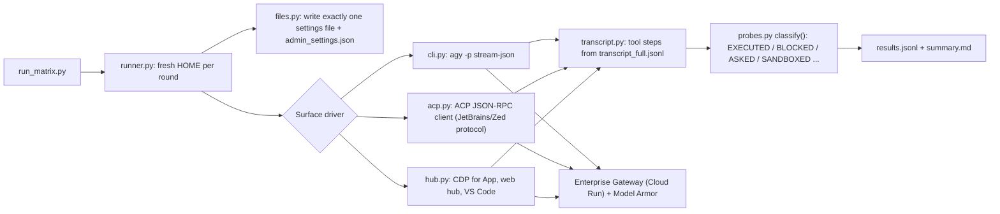

# AGY settings-scope verification

This folder holds the test harness, the evidence summaries, and the minimal baseline from the November 2026 live verification. The verification answers one question: **which Antigravity (AGY) settings file does each surface honor in Enterprise Gateway mode?** The answer decides whether `~/.gemini/antigravity-cli/settings.json` alone can carry an organization's security policy. It can't (see [Results](#results)).

> [!IMPORTANT]
> Results apply to the versions tested: CLI 1.4.12, desktop App / web hub 2.28.2, VS Code extension 1.10.0, ACP server 1.4.5, on Ubuntu 22.04 and Windows Server 2022, in Enterprise Gateway mode (no Google sign-in). macOS was not live-tested. Re-run the harness after every client upgrade.

## Results

- **Full report:** [`../SETTINGS_SCOPE_VERIFICATION_REPORT.md`](../SETTINGS_SCOPE_VERIFICATION_REPORT.md) (complete control × surface × file matrix, per-case placement outcomes, 12 security findings with reproduction steps, and P4 locked baseline results).
- **Evidence:** [`evidence/`](evidence/) holds the redacted per-run result tables (`results.jsonl`, `summary.md`, `reclassified_*.md`).
- **Minimal baseline:** [`minimal-baseline/`](minimal-baseline/) holds the smallest file set that enforced the tested controls on every surface, plus deploy-and-lock scripts.

## Application Architecture

The harness drives each AGY surface the way a developer would, with one settings file changed per test case, and judges the outcome from the surface's own transcript and from side effects on disk. It never trusts what the model says it did.



- **Placement experiments.** Each control is tested with its setting in exactly one candidate file: CLI `settings.json`, `config.json`, `hooks.json`, `mcp_config.json`, a workspace file, `admin_settings.json`, or a CLI flag. Every other file stays absent. A control case with no settings shows the default.
- **Benign probes.** Each case asks the agent for one harmless action, such as creating an empty marker file, reading a canary file, calling a probe MCP tool, or a HEAD request to example.com.
- **Approvals.** Deny tests approve every permission prompt, so only a configured rule can block. Ask tests reject every prompt, so a prompt shows up as `ASKED`.
- **Oracle.** The transcript steps and the side effects on disk decide the verdict. `tools/reclassify.py` re-judges finished rounds offline after a classifier fix.
- **Gateway screening.** The shared gateway runs Model Armor inline. Every probe prompt is pre-screened through the gateway's Model Armor template before a run, so screening can't masquerade as a client control.

## Project Directory Structure

```text
verification/
├── README.md                     # this file
├── .gitignore                    # keeps secrets, raw evidence and round folders out of git
├── settings.env.example          # configuration keys for the bench (copy to settings.env)
├── infra/
│   ├── provision_test_vms.sh     # IAP-only firewall rule + Linux/Windows test VMs
│   ├── deprovision_test_vms.sh   # deletes the bench (label-guarded)
│   ├── startup_linux_test.sh     # installs CLI, App, VS Code + VSIX, ACP server, Chrome, Xvfb
│   └── startup_windows_test.ps1  # installs CLI, ACP server, Python, Chrome; stages App/VS Code
├── harness/
│   ├── run_matrix.py             # entry point: --surfaces --cases --run-id --retries --list
│   ├── agyv/
│   │   ├── env.py                # paths, gateway loading, redaction
│   │   ├── files.py              # writers for every settings file (atomic admin_settings.json)
│   │   ├── cases.py              # the case catalog (D1–D14 placements + P4 baseline)
│   │   ├── probes.py             # benign actions, prompts, classifier
│   │   ├── runner.py             # one round = fresh HOME, files, probe, verdict, evidence
│   │   ├── transcript.py         # transcript_full.jsonl → tool steps
│   │   ├── cdp.py                # Chrome DevTools Protocol client
│   │   └── surfaces/             # cli.py, acp.py, hub.py drivers
│   └── tools/
│       ├── guard_hook.py         # PreToolUse/PostToolUse probe guard (blocks the token "hookblock")
│       ├── probe_mcp_server.py   # stdio MCP server with probe_echo / probe_extra
│       ├── tui_probe.py          # drives the interactive CLI in tmux and records screens
│       ├── explore_ui.py         # CDP inspector & one-off probe runner for App, web hub, VS Code
│       ├── capture_gateway_request.py  # mock gateway that records what a client sends
│       └── reclassify.py         # re-judges finished rounds with the current classifier
├── minimal-baseline/
│   ├── files/                    # admin_settings.json, config.json, cli-settings.json, hooks.json, mcp_config.json, antigravity-acp-settings.json
│   ├── guard/                    # agy_guard.sh (Linux/macOS), agy_guard.ps1 (Windows)
│   ├── deploy/                   # deploy_baseline.sh / deploy_baseline.ps1 (render, install, lock)
│   └── README.md                 # what each file does, per-surface coverage, lock commands
└── evidence/                     # redacted result tables per run (raw evidence is git-ignored)
```

## Frameworks & Libraries

- **Python 3.10+ standard library** for the harness (no third-party packages on Windows).
- **websocket-client** (Linux bench only) for the CDP driver.
- **tmux** (Linux) for the interactive CLI probe.
- **Google Cloud SDK** (`gcloud`) for provisioning, IAP SSH/SCP, and Model Armor pre-screening.
- **Antigravity surfaces under test:** CLI (`agy`), desktop App, `agy --hub` web UI, Google Antigravity VS Code extension, `agy_acp_server` (JetBrains/Zed protocol).

## Environment Variables

| Key | Type | Purpose | Example |
|---|---|---|---|
| `PROJECT_ID` | string | Project that hosts the gateway and the bench | `my-project` |
| `ZONE` | string | Zone for the test VMs | `europe-west1-b` |
| `NETWORK` / `SUBNET` | string | VPC network and subnet for the VMs | `corp-vpc` / `corp-subnet-ew1` |
| `FIREWALL_RULE` / `NETWORK_TAG` | string | IAP-only ingress rule and its target tag | `agy-scope-allow-iap` / `agy-scope-iap` |
| `LINUX_VM` / `WINDOWS_VM` | string | Test VM names | `agy-scope-linux` / `agy-scope-windows` |
| `MACHINE_TYPE` | string | VM size (GUI surfaces need 8 vCPU) | `e2-standard-8` |
| `GATEWAY_URL` | URL | Enterprise Gateway base URL (HTTPS only) | `https://gateway.example.com` |
| `GATEWAY_API_KEY_FILE` | path | File holding the gateway API key (the key itself is never an env value) | `/secure/gateway_api_key.txt` |
| `MODEL_ARMOR_REGION` / `MODEL_ARMOR_TEMPLATE` | string | Template used for prompt pre-screening | `europe-west1` / `agy-enterprise-armor` |
| `AGYV_TEST_USER` | string | (VM) non-root OS user that runs surfaces on Linux | `agyt` |
| `AGYV_GATEWAY_URL` / `AGYV_GATEWAY_API_KEY_FILE` | string | (VM) optional overrides of the bench secrets folder | — |

> [!CAUTION]
> No secrets are hard-coded. On the VMs the gateway key lives in `/etc/agy-verify/gateway_api_key` (0600, root) or `C:\ProgramData\agy-verify\secrets\gateway_api_key`. The harness redacts the key and URL from all evidence (`<REDACTED_GATEWAY_KEY>`, `<GATEWAY_URL>`).

## Local Execution Instructions

```bash
# 1. Configure
cd agy-config/verification
cp settings.env.example settings.env        # fill in your values
chmod 600 settings.env

# 2. Create the bench (IAP-only VMs; installs every surface)
bash infra/provision_test_vms.sh settings.env

# 3. Copy the gateway secrets and the harness to the Linux VM
source settings.env
gcloud compute scp "$GATEWAY_API_KEY_FILE" "$LINUX_VM":/tmp/gateway_api_key --zone="$ZONE" --project="$PROJECT_ID" --tunnel-through-iap
gcloud compute scp --recurse harness minimal-baseline "$LINUX_VM":/tmp/ --zone="$ZONE" --project="$PROJECT_ID" --tunnel-through-iap
gcloud compute ssh "$LINUX_VM" --zone="$ZONE" --project="$PROJECT_ID" --tunnel-through-iap --command="sudo install -d -m 0700 /etc/agy-verify && sudo install -m 0600 /tmp/gateway_api_key /etc/agy-verify/gateway_api_key && rm -f /tmp/gateway_api_key && echo GATEWAY_URL=$GATEWAY_URL | sudo tee /etc/agy-verify/gateway.env && sudo cp -r /tmp/harness /tmp/minimal-baseline /opt/agy-verify/"

# 4. Run a matrix slice (as root on the VM)
gcloud compute ssh "$LINUX_VM" --zone="$ZONE" --project="$PROJECT_ID" --tunnel-through-iap --command="sudo /opt/agy-verify/venv/bin/python /opt/agy-verify/harness/run_matrix.py --surfaces cli,acp --cases 'D3.*' --run-id r1"

# 5. Delete the bench when done
bash infra/deprovision_test_vms.sh settings.env
```

- **Windows bench.** Use `--scp-flag=-O` for `gcloud compute scp` (the Windows OpenSSH server needs the legacy SCP protocol), then run `C:\Windows\py.exe -3 C:\ProgramData\agy-verify\harness\run_matrix.py ...`.
- **Model Armor pre-screening.** Before a long run, screen the exact prompts with `gcloud model-armor templates sanitize-user-prompt`. Neutral run ids such as `r1` or `w5` pass. Hex strings, case ids, or words like "smoke" in paths were flagged.

## Cloud Deployment Playbooks

The GUI surfaces (App, VS Code) need a desktop session, so the full matrix runs on the VMs above. The headless slice (CLI and ACP) can run as a container job against a staging gateway. Use it as a regression gate after client upgrades.

**Cloud Run job (headless CLI/ACP slice):**

```bash
# Container: Ubuntu 22.04 + agy CLI + agy_acp_server + this harness; admin_settings.json comes from Secret Manager.
gcloud run jobs create agy-settings-scope \
  --project="$PROJECT_ID" --region=europe-west1 \
  --image="europe-west1-docker.pkg.dev/$PROJECT_ID/agy/settings-scope:latest" \
  --set-secrets=/etc/agy-verify/gateway_api_key=agy-gateway-api-key:latest \
  --set-env-vars=AGYV_GATEWAY_URL="$GATEWAY_URL" \
  --command=/opt/agy-verify/venv/bin/python \
  --args=/opt/agy-verify/harness/run_matrix.py,--surfaces,cli,--run-id,ci \
  --task-timeout=3600 --max-retries=0
gcloud run jobs execute agy-settings-scope --project="$PROJECT_ID" --region=europe-west1 --wait
```

**GKE Job (same image):**

```yaml
apiVersion: batch/v1
kind: Job
metadata:
  name: agy-settings-scope
spec:
  backoffLimit: 0
  activeDeadlineSeconds: 3600
  template:
    spec:
      restartPolicy: Never
      containers:
        - name: harness
          image: europe-west1-docker.pkg.dev/PROJECT_ID/agy/settings-scope:latest
          command: ["/opt/agy-verify/venv/bin/python", "/opt/agy-verify/harness/run_matrix.py"]
          args: ["--surfaces", "cli,acp", "--run-id", "ci"]
          env:
            - name: AGYV_GATEWAY_URL
              valueFrom: { secretKeyRef: { name: agy-gateway, key: url } }
            - name: AGYV_GATEWAY_API_KEY_FILE
              value: /secrets/gateway_api_key
          volumeMounts:
            - { name: gateway-key, mountPath: /secrets, readOnly: true }
      volumes:
        - name: gateway-key
          secret: { secretName: agy-gateway, items: [{ key: api_key, path: gateway_api_key }] }
```

> [!NOTE]
> The Cloud Run and GKE recipes cover only the headless surfaces, and the image isn't published by this repo. Build it from `infra/startup_linux_test.sh` (CLI and ACP sections) plus the `harness/` folder.
