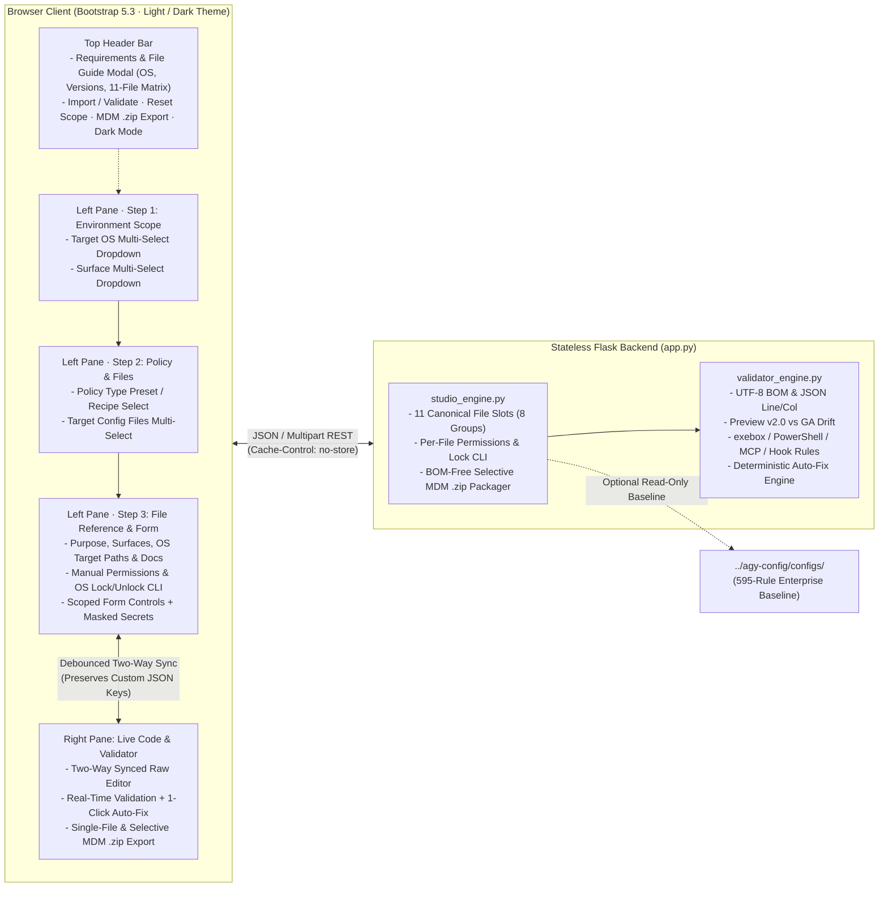

<!--
==============================================================================
FILE HEADER: Documentation — Antigravity Admin Policy Studio
==============================================================================
Purpose:
  Production documentation for the stateless Flask + Bootstrap 5.3 Antigravity
  Admin Policy Studio web application (`agy-policy-studio/`).

Architecture / Context:
  Fourth module of the Antigravity Enterprise Suite alongside
  `enterprise-gateway/`, `vm-provisioning/`, and `agy-config/`. Enables
  administrators to author, import, validate, auto-remediate, and package MDM
  policies across Linux, macOS, and Windows and across AGY CLI, Desktop, Web
  Hub, and IDE Plugins.

Dependencies / Side Effects:
  Documentation only. Contains zero hardcoded credentials, API keys, or cloud
  project identifiers.
==============================================================================
-->

> [!CAUTION]
> **DISCLAIMER — TEST & REFERENCE APPLICATION ONLY (NO WARRANTY)**
>
> **This application is provided for testing, prototyping, and reference only, with NO warranty of any kind.** Review all generated configuration files and OS immutability commands in a staging environment before deploying to production developer fleets.

# Antigravity Admin Policy Studio (`agy-policy-studio`)

A crisp, stateless **Python Flask + Bootstrap 5.3** web application that allows Enterprise Administrators to **create, edit, import, validate, auto-fix, and export** all **8 canonical Google Antigravity configuration groups** across **Linux**, **macOS**, and **Windows**, and across every client surface (**AGY CLI**, **AGY Desktop**, **AGY Web Hub (`agy --hub`)**, and **AGY IDE Plugins** — VS Code, Visual Studio, JetBrains IDEs, and Zed).

### Official Public Documentation References
- **Admin Deployment Guide**: https://docs.cloud.google.com/gemini/enterprise/docs/ai-developer-tools/deploy-enterprise-gateway?hl=en
- **Developer Connection Guide**: https://docs.cloud.google.com/gemini/enterprise/docs/ai-developer-tools/connect-enterprise-gateway?hl=en
- **CLI & Sandbox Settings**: https://antigravity.google/docs/cli/reference/ · https://antigravity.google/docs/sandbox/

---

## Application Architecture

The Policy Studio uses a **100% stateless Progressive Multi-Select Split-Pane Architecture** with zero database or disk persistence:



### Supported Canonical Configuration Groups (All 8 Modules)
| Group | Canonical File | Supported Surfaces | Target OS Paths (Linux / macOS / Windows) |
| :--- | :--- | :--- | :--- |
| **01** | `admin_settings.json` | CLI, Desktop, Web Hub, IDEs | `/etc/antigravity/admin_settings.json` · `/Library/Application Support/Antigravity/admin_settings.json` · `C:\ProgramData\Antigravity\admin_settings.json` |
| **01b** | `antigravity-gateway.env` | CLI, Desktop, Web Hub, IDEs | `/etc/profile.d/antigravity-gateway.sh` · `/etc/zshrc` · `HKLM\...\Environment` |
| **02** | `settings.json` | CLI, VS Code, Visual Studio | `~/.gemini/antigravity-cli/settings.json` (`%USERPROFILE%\.gemini\antigravity-cli\settings.json`) |
| **03** | `config.json` | Desktop App, Web Hub (`agy --hub`) | `~/.gemini/config/config.json` (`%USERPROFILE%\.gemini\config\config.json`) |
| **04** | `browserAllowlist.txt` | Desktop App, Web Hub | `~/.gemini/antigravity/browserAllowlist.txt` |
| **05** | `mcp_config.json` | CLI, Desktop, Web Hub, IDEs | `~/.gemini/config/mcp_config.json` |
| **06** | `hooks.json` | CLI, Desktop, Web Hub, IDEs | `~/.gemini/config/hooks.json` |
| **07** | `agy_security_guard.{sh,ps1}` | CLI, Desktop, Web Hub, IDEs | `/usr/local/bin/agy_security_guard.sh` · `C:\ProgramData\Antigravity\bin\agy_security_guard.ps1` |
| **08** | `acp.json` & `antigravity-acp/settings.json` | JetBrains IDEs, Zed | `~/.jetbrains/acp.json` & `~/.gemini/antigravity-acp/settings.json` |

### Built-In Runtime Validator & 1-Click Auto-Fix Coverage
1. **UTF-8 BOM Detection (`ERR_UTF8_BOM`)**: Flags and strips leading `0xEF 0xBB 0xBF` bytes written by Windows PowerShell 5.1 that break Go `encoding/json.Unmarshal` in `agy.exe`.
2. **Preview v2.0 vs. Official GA Drift**: Automatically hoists nested `gateway.caCertPath`, migrates `models.filter` to top-level `models.list`, removes deprecated `auth.suppressInteractiveLogin`, and converts JSON `AGY_LLM_GATEWAY_HEADERS` to comma-separated `Key: Value` pairs.
3. **JetBrains & Zed ACP Wire Protocol Guard (`ERR_ACP_OPENAI_UNSUPPORTED`)**: Flags `wireProtocol: "openai"` when IDE/ACP surfaces are active and switches to `"genai"`.
4. **Sandbox & `exebox` Footgun Protection**: Catches fatal `"unsandboxed(*)"` deny entries, wildcard `*` globs / relative paths / Windows `C:\` paths in POSIX file grants, root system directory (`write_file(/usr)`, `write_file(/bin)`) mounts that hide `/usr/bin/bash`, and multi-CA bundles in `sandboxProxy.http.certFile`.
5. **Windows PowerShell `RequiresExactMatch` Companions**: Detects bare `command(echo)` / `command(git status)` grants on Windows and injects safe anchored `command(regex:...)` + `unsandboxed(...)` companions.
6. **MCP & Hook Governance**: Warns when `"eager": true` bypasses `call_mcp_tool` `mcp(...)` deny rules, flags enabled `example.com` servers, upgrades `.toolCall.toolName` to `.toolCall.name`, ensures `sed_file` is included in file-write DLP matchers, and scrubs live plaintext secrets to `${REPLACE_WITH_GATEWAY_API_KEY}`.

---

## Project Directory Structure

```text
agy-policy-studio/
├── README.md                       # Architecture, env vars, local run & Cloud Run/GKE playbooks
├── app.py                          # Stateless Flask 3.1 server & REST API routes (/health, /api/*)
├── studio_engine.py                # 8-group file catalog, presets/recipes, 2-way sync & MDM ZIP builder
├── validator_engine.py             # Cross-OS schema/runtime validator & deterministic Auto-Fix engine
├── requirements.txt                # Pinned Flask, Werkzeug, Gunicorn, python-dotenv & pytest
├── run.sh                          # 1-command local virtualenv bootstrapper & launcher (port 8090)
├── .env.example                    # Externalized configuration template (zero secrets)
├── .gitignore                      # Excludes .env, .venv, __pycache__, certificates, logs & .zip exports
├── Dockerfile                      # Hardened air-gapped python:3.12-slim non-root Gunicorn container
├── k8s/
│   └── deployment.yaml             # Production GKE ConfigMap, non-root Deployment & ClusterIP Service
├── vendor/
│   └── wheels/                     # Offline Python wheelhouse (Flask, Werkzeug, Gunicorn, dotenv, pytest)
├── templates/
│   └── index.html                  # Air-gapped HTML5 Split-Pane UI (zero external CDN or font requests)
├── static/
│   ├── css/
│   │   ├── fonts.css               # Local @font-face rules for self-hosted Inter & JetBrains Mono
│   │   └── studio.css              # HSL design tokens (Light & Dark), split-pane grid & chip styles
│   ├── js/
│   │   └── studio.js               # Two-way Form <-> Code controller, drag/drop importer & downloads
│   └── vendor/
│       ├── bootstrap/              # Self-hosted Bootstrap 5.3.3 CSS & JS bundle (with Popper)
│       └── fonts/                  # Self-hosted Inter (400–700) & JetBrains Mono (400–600) WOFF2 fonts
└── tests/
    └── test_studio.py              # Comprehensive pytest suite covering APIs, air-gapped CSP & Auto-Fixes
```

---

## Frameworks & Libraries (100% Vendored Locally — Air-Gapped Ready)

All frontend stylesheets, JavaScript bundles, webfonts (`static/vendor/`), and backend Python wheel archives (`vendor/wheels/`) are bundled directly inside `agy-policy-studio/` so both the browser UI and `./run.sh` / `Dockerfile` operate with **zero public internet access**:

| Component | Package / Library | Version | Responsibility |
| :--- | :--- | :--- | :--- |
| **Backend Web Framework** | `Flask` & `Werkzeug` *(vendored in `vendor/wheels/`)* | `3.1.0` / `3.1.3` | Stateless routing, multipart upload handling, strict `self` CSP headers, and JSON serialization. |
| **Production WSGI Server** | `gunicorn` *(vendored in `vendor/wheels/`)* | `23.0.0` | Multi-worker threaded HTTP server for Docker, Cloud Run, and GKE. |
| **Environment Loader** | `python-dotenv` *(vendored in `vendor/wheels/`)* | `1.0.1` | Loads optional local `.env` overrides without mutating OS/container env vars. |
| **Frontend UI & Fonts** | `Bootstrap` + `Inter` & `JetBrains Mono` *(in `static/vendor/`)* | `5.3.3` | Self-hosted responsive split-pane layout, Light/Dark theming, modals, toasts, and typography. |
| **Test Harness** | `pytest` *(vendored in `vendor/wheels/`)* | `8.3.5` | Automated verification of REST endpoints, air-gapped static assets, BOM stripping, and Auto-Fix rules. |

---

## Environment Variables

All runtime behavior is controlled via external environment variables (with safe defaults when unset):

| Variable | Type | Default | Description & Example |
| :--- | :--- | :--- | :--- |
| `FLASK_HOST` | `string` | `"0.0.0.0"` | Network interface address to bind (`"127.0.0.1"` for loopback-only local use). |
| `PORT` | `integer` | `8090` | HTTP listen port (automatically injected by Google Cloud Run). |
| `FLASK_DEBUG` | `boolean` | `"false"` | Enables Flask reloader during local UI development (`"true"` or `"false"`). |
| `LOG_LEVEL` | `string` | `"INFO"` | Structured Python logging threshold (`"DEBUG"`, `"INFO"`, `"WARNING"`, `"ERROR"`). |
| `MAX_UPLOAD_MB` | `integer` | `16` | Maximum request size in MiB for imported files or `.zip` policy bundles (`1`–`64`). |
| `DEFAULT_DEV_USER` | `string` | `"alice"` | Initial workstation developer username populated into path templates. |
| `REPO_BASELINE_DIR` | `string` | `"../agy-config/configs"` | Path to sibling canonical baseline configs (falls back to embedded templates in standalone containers). |

---

## No Hardcoding Rule

- **Zero Hardcoded Credentials or Project IDs**: No API keys, OAuth secrets, proxy passwords, or customer GCP project IDs are hardcoded anywhere in `app.py`, `studio_engine.py`, `validator_engine.py`, `templates/`, or `static/`.
- **Stateless Zero-Persistence Design**: Uploaded configurations, pasted snippets, and generated `.zip` bundles are processed exclusively in memory (`io.BytesIO`) with `Cache-Control: no-store, max-age=0` on all `/api/*` endpoints and zero secret values written to logs or disk.
- Copy [`.env.example`](./.env.example) to `.env` for local environment customization; `.env` is strictly excluded by [`.gitignore`](./.gitignore).

---

## Local Execution Instructions

```bash
# 1. Navigate to the Policy Studio directory
cd agy-policy-studio

# 2. (Optional) Copy environment template and customize PORT or DEFAULT_DEV_USER
cp .env.example .env

# 3. Launch via the automated virtualenv runner (starts on http://localhost:8090)
./run.sh
```

Or run manually and execute the automated verification suite:

```bash
python3 -m venv .venv
source .venv/bin/activate
pip install -r requirements.txt

# Run the automated pytest verification suite
pytest -v

# Start with Gunicorn for production-parity local testing
gunicorn --bind 0.0.0.0:8090 --workers 2 --threads 4 app:app
```

---

## Cloud Deployment Playbooks

### 1. Deploy to Google Cloud Run

Because the Policy Studio is an internal administrator tool (not the LLM proxy), you can protect it with **Cloud Run IAM / Identity-Aware Proxy (IAP)** so only authorized platform administrators can open the UI:

```bash
export PROJECT_ID="REPLACE_WITH_PROJECT_ID"
export REGION="europe-west1"
export SERVICE_NAME="agy-policy-studio"

# Build & deploy directly from source using Cloud Build + Cloud Run
gcloud run deploy "${SERVICE_NAME}" \
  --source . \
  --project "${PROJECT_ID}" \
  --region "${REGION}" \
  --port 8090 \
  --memory 512Mi \
  --cpu 1 \
  --min-instances 0 \
  --max-instances 5 \
  --set-env-vars "LOG_LEVEL=INFO,MAX_UPLOAD_MB=16,DEFAULT_DEV_USER=alice" \
  --no-allow-unauthenticated

# Access securely as an authenticated administrator via gcloud proxy:
gcloud run services proxy "${SERVICE_NAME}" --project "${PROJECT_ID}" --region "${REGION}" --port 8090
```

### 2. Deploy to Google Kubernetes Engine (GKE)

```bash
export PROJECT_ID="REPLACE_WITH_PROJECT_ID"
export REGION="europe-west1"
export K8S_NS="antigravity-admin"
export IMAGE="${REGION}-docker.pkg.dev/${PROJECT_ID}/antigravity/agy-policy-studio:v1"

# 1. Build and push the hardened non-root container image to Artifact Registry
gcloud builds submit . --tag "${IMAGE}" --project "${PROJECT_ID}"

# 2. Create namespace and apply the GKE manifest
kubectl create namespace "${K8S_NS}" --dry-run=client -o yaml | kubectl apply -f -

sed "s|REPLACE_WITH_CONTAINER_IMAGE|${IMAGE}|g" k8s/deployment.yaml \
  | kubectl -n "${K8S_NS}" apply -f -

# 3. Verify rollout and readiness probes (/health)
kubectl -n "${K8S_NS}" rollout status deployment/agy-policy-studio
kubectl -n "${K8S_NS}" port-forward svc/agy-policy-studio 8090:80
```
