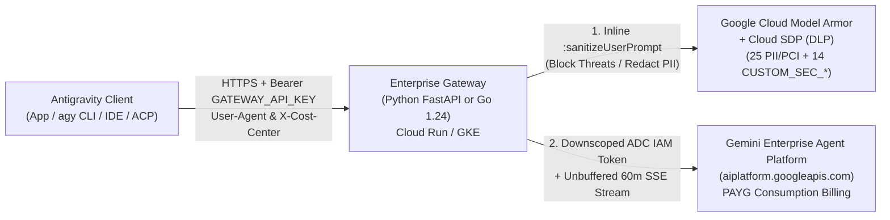

# Antigravity Enterprise Gateway — Unified Cloud Run, GKE & Model Armor Package

Production-ready, block-structured implementation of the **Google Antigravity Enterprise Gateway** pairing interchangeable **Python 3.12 (`FastAPI`)** and **Go 1.24 (`net/http`)** reverse-proxy runtimes with **Google Cloud Model Armor** and **Cloud Sensitive Data Protection (SDP / DLP)** under a single unified settings file ([`settings.env`](./settings.env)) and one-command installer ([`install.sh`](./install.sh)) / uninstaller ([`uninstall.sh`](./uninstall.sh)).

---

## Application Architecture

The Enterprise Gateway operates inside your Google Cloud perimeter (Cloud Run or GKE) so developer workstations running Google Antigravity (Desktop App `2.15.0+`, `agy` CLI `1.2.15+`, VS Code / Visual Studio, and JetBrains / Zed ACP `1.3.0+`) connect using a centralized bearer key without interactive Google OAuth login or direct workstation access to `aiplatform.googleapis.com`.



### Block-Level Code Design (Symmetric Across Python & Go)
Both [`python/`](./python/) and [`go/`](./go/) are organized into **7 identical logical blocks** so platform engineers can audit, extend, or switch runtimes effortlessly:

- **Core Server (`main.py` / `main.go`)**:
  - **Block 1**: Unified Settings & Environment Variable Loader (`OS Env > .env > settings.env > Fallback`).
  - **Block 2**: Operational Constants (`4 KiB` unbuffered SSE chunk size) & Structured JSON Logging (`INFO` / `DEBUG`).
  - **Block 3**: Thread-Safe GCP IAM Token Manager (`google-auth` / `oauth2.ReuseTokenSource` with `https://www.googleapis.com/auth/cloud-platform`).
  - **Block 4**: Server Lifespan / Initialization & `3600s` Upstream Connection Pool.
  - **Block 5**: Internal Health Probe (`GET /healthz`), Telemetry Short-Circuiting & Optional SIEM Ingestion (`POST /v1beta:*` & `/v1internal:*` $\rightarrow$ `200 OK {}` + structured JSON telemetry logging when `LOG_TELEMETRY_PAYLOADS="true"`), Google RPC Error Formatter, and Conversational Policy Block Builder (`HTTP 200` SSE/JSON with `X-Model-Armor-Blocked: true`).
  - **Block 6**: Core 9-Stage Reverse Proxy Pipeline — Constant-time single or multi-key verification (`hmac.compare_digest` / `subtle.ConstantTimeCompare`), route resolution (both `genai` `/v1beta/models/...` and `openai` `/v1/chat/completions`), `MODEL_PLACEHOLDER_M50` Flash fallback rewrite, history scrubbing, Gemini 4 thinking normalization, Model Armor enforcement, `User-Agent` & `X-*` PAYG billing attribution preservation, multi-region `429`/`503` failover, and immediate SSE chunk flushing.
  - **Block 7**: HTTP Server Entrypoint & Graceful `SIGINT`/`SIGTERM` Shutdown.
- **Routing & Security Engine (`routing_and_armor.py` / `routing_and_armor.go`)**:
  - Dynamic Cost-Center project chargeback (`X-Cost-Center` $\rightarrow$ `PROJECT_ID` + `X-Goog-User-Project`), Provisioned Throughput (`-pt` $\rightarrow$ `X-Vertex-AI-LLM-Request-Type: dedicated`), Gemini 4 thinking-level suffix aliases (`gemini-4-argon-high`/`-medium`/`-low`), OpenAI Chat Completions translation (`/endpoints/openapi/chat/completions` with `"google/{MODEL_ID}"` or custom `OPENAI_UPSTREAM_BASE_URL`), `MODEL_PLACEHOLDER_M50` Flash fallback, multi-turn blocked-prompt scrubbing, and inline/native Model Armor integration across GenAI `contents[]` and OpenAI `messages[]`.

---

## Project Directory Structure

```text
enterprise-gateway/
├── README.md                              # Architecture, setup, local execution & Cloud Run / GKE playbooks
├── CONFIGURATION_REFERENCE.md             # Full dictionary of settings.env, .env, and 3-tier client settings
├── settings.env                           # Unified non-secret configuration defaults (Runtime, Cloud Run, Armor, Routing)
├── .env.example                           # Template for git-ignored local secret overrides (GATEWAY_API_KEY)
├── .gitignore                             # Blocks .env*, *.local.json, certs/keys, binaries, and venvs
├── admin_settings.json                    # Sanitized Tier-1 MDM client configuration template
├── install.sh                             # Unified installer (interactive GCP project picker + Model Armor + Cloud Run)
├── uninstall.sh                           # Unified dependency-ordered uninstaller (Cloud Run -> Armor -> SDP)
├── k8s/
│   └── deployment.yaml                    # Production GKE ConfigMap, Workload Identity SA, Deployment & 3600s BackendConfig
├── go/                                    # Go 1.24 Gateway Runtime
│   ├── main.go                            # BLOCK 1..7: HTTP reverse proxy, auth, telemetry, failover & SSE flusher
│   ├── routing_and_armor.go               # BLOCK 1..7: Dynamic routing, Gemini 4 thinking normalizer & Model Armor client
│   ├── go.mod                             # Go 1.24 module specification
│   ├── go.sum                             # Verified dependency checksums
│   └── Dockerfile                         # Multi-stage Alpine 3.21 static binary build (non-root user)
├── python/                                # Python 3.12 Gateway Runtime
│   ├── main.py                            # BLOCK 1..7: Async FastAPI reverse proxy, auth, telemetry & SSE generator
│   ├── routing_and_armor.py               # BLOCK 1..7: Dynamic routing, Gemini 4 thinking normalizer & Model Armor client
│   ├── requirements.txt                   # Pinned FastAPI, Uvicorn, httpx, google-auth, python-dotenv versions
│   └── Dockerfile                         # Hardened python:3.12-slim container build (non-root user)
└── model-armor-sdp/                       # Google Cloud Model Armor + Cloud SDP (DLP) Security Module
    ├── README.md                          # Threat-domain coverage matrix & standalone CLI usage
    ├── model_armor_manager.sh             # BLOCK 1..7: Provision, 9-test verify & deprovision engine
    └── templates/
        ├── sdp_inspect_template.json      # 25 built-in PCI/Credential/PII InfoTypes + 14 CUSTOM_SEC_* regexes
        ├── sdp_deidentify_template.json   # Cloud SDP [INFOTYPE] masking transformation spec
        └── model_armor_filters.json       # Model Armor RAI filter confidence thresholds
```

---

## Frameworks & Libraries

### Python Runtime (`python/`)
- **Python 3.12+**
- **`fastapi==0.115.11`** — Asynchronous HTTP routing and streaming response handling.
- **`uvicorn[standard]==0.34.0`** — High-concurrency ASGI server (`timeout_keep_alive=3600`).
- **`httpx==0.28.1`** — Pooled async upstream HTTP/1.1 streaming client (`aiter_bytes`).
- **`google-auth==2.38.0` & `requests==2.32.3`** — Google Cloud Application Default Credentials (ADC) token minting and caching.
- **`python-dotenv==1.0.1`** — Deterministic `.env` and `settings.env` parsing.

### Go Runtime (`go/`)
- **Go 1.24+** (`net/http`, `crypto/subtle`, `log/slog`) — Zero-dependency standard library reverse proxy and structured JSON logger.
- **`golang.org/x/oauth2 v0.28.0`** — Cached Google Cloud IAM `DefaultTokenSource` / `ReuseTokenSource`.

### Infrastructure & Security Tooling
- **Google Cloud CLI (`gcloud`)**, **`jq`**, **`curl`**, and **`openssl`** — Used by `install.sh`, `uninstall.sh`, and `model_armor_manager.sh`.

---

## Environment Variables

Non-secret operational defaults live in [`settings.env`](./settings.env); sensitive local secrets belong in a git-ignored `.env` copied from [`.env.example`](./.env.example). See [`CONFIGURATION_REFERENCE.md`](./CONFIGURATION_REFERENCE.md) for the complete reference.

| Key | Data Type | Default / Source | Purpose | Example Value |
| :--- | :--- | :--- | :--- | :--- |
| `PROJECT_ID` | `string` | `""` (`settings.env`) | Default GCP Project ID (`install.sh` lists projects interactively when blank). | `"cymbal-ai-prod"` |
| `GATEWAY_RUNTIME` | `string` | `"python"` (`settings.env`) | Gateway runtime deployed by `install.sh` (`python` or `go`). | `"python"` |
| `GATEWAY_API_KEY` | `string` | Secret Manager / `.env` | Shared ingress bearer secret(s) validated in constant time (comma-separated supported for rotation). **Never hardcode.** | `"K8x9...base64..."` |
| `REGION` | `string` | `"europe-west1"` | Default Cloud Run and regional Model Armor / SDP location. | `"europe-west1"` |
| `PORT` | `integer` | `"8080"` | Container / local HTTP listen port. | `"8080"` |
| `LOG_LEVEL` | `string` | `"INFO"` | JSON log level (`INFO` or `DEBUG`). | `"INFO"` |
| `LOG_TELEMETRY_PAYLOADS` | `boolean` | `"false"` | Logs full `/v1internal:*` & `/v1beta:*` telemetry JSON payloads to stdout for SIEM / BigQuery sinks. | `"true"` |
| `CLOUD_RUN_INGRESS` | `string` | `"all"` | Cloud Run ingress control (`"all"`, `"internal"`, or `"internal-and-cloud-load-balancing"`). **Never** enable Cloud Run IAM invoker checks on `Authorization`. | `"internal"` |
| `ENABLE_MODEL_ARMOR` | `boolean` | `"true"` | Provisions and enforces Model Armor + Cloud SDP templates. | `"true"` |
| `MODEL_ARMOR_MODE` | `string` | `"inline"` | `"inline"`, `"native"`, or `"disabled"`. | `"inline"` |
| `MODEL_ARMOR_TEMPLATE_ID` | `string` | `"agy-enterprise-armor"` | Regional Model Armor template ID. | `"agy-enterprise-armor"` |
| `MODEL_ARMOR_FAIL_CLOSED` | `boolean` | `"true"` | Blocks with HTTP `502` if inline Model Armor is unreachable. | `"true"` |
| `COST_CENTER_PROJECT_MAP` | `string` | `""` | Optional `X-Cost-Center=PROJECT_ID` routing map. | `"Fin=cymbal-fin-prod"` |
| `MODEL_REGION_MAP` | `string` | `""` | Optional `MODEL_ID=REGION` override map. | `"gemini-3.8-flash=europe-west1"` |
| `FAILOVER_REGIONS` | `string` | `""` | Optional comma-separated secondary regions for `429`/`503` failover. | `"europe-west4,europe-west3"` |
| `DEFAULT_FLASH_FALLBACK_MODEL` | `string` | `"gemini-3.8-flash"` | Flash model substituted if an unpatched client emits `MODEL_PLACEHOLDER_M50`. | `"gemini-3.8-flash"` |
| `OPENAI_UPSTREAM_BASE_URL` | `string` | `""` | Optional custom OpenAI upstream for `/v1/chat/completions` (blank routes to Vertex AI `/endpoints/openapi/chat/completions`). | `"https://litellm.corp.internal"` |

---

## Local Execution Instructions

1. **Authenticate Google Application Default Credentials (ADC)**:
   ```bash
   gcloud auth application-default login
   ```

2. **Create a local `.env` file from `.env.example` (never committed to Git)**:
   ```bash
   cd enterprise-gateway
   cp .env.example .env
   ```
   Edit `.env` and set `PROJECT_ID="your-gcp-project-id"` and `GATEWAY_API_KEY="$(openssl rand -base64 32)"` (and set `ENABLE_MODEL_ARMOR="false"` if you have not provisioned Model Armor templates yet).

3. **Option A — Run the Python 3.12 Gateway locally**:
   ```bash
   cd python
   python3 -m venv .venv
   source .venv/bin/activate
   pip install -r requirements.txt
   python main.py
   ```

4. **Option B — Run the Go 1.24 Gateway locally**:
   ```bash
   cd go
   go run .
   ```

5. **Verify local health and telemetry endpoints**:
   ```bash
   curl -i http://localhost:8080/healthz
   curl -i -X POST http://localhost:8080/v1beta:recordCodeAssistMetrics \
     -H "Authorization: Bearer $(grep '^GATEWAY_API_KEY=' .env | cut -d= -f2- | tr -d '\"')" \
     -H "Content-Type: application/json" \
     -d '{}'
   ```

---

## Cloud Deployment Playbooks

### 1. Google Cloud Run (Unified One-Command Installer & Uninstaller)

[`install.sh`](./install.sh) automatically:
1. Queries `gcloud projects list` and displays **all accessible GCP projects** in a numbered menu so you can pick the target `PROJECT_ID`.
2. Displays all default settings from [`settings.env`](./settings.env) (`GATEWAY_RUNTIME`, `REGION`, `SERVICE_NAME`, `ENABLE_MODEL_ARMOR`, `MODEL_ARMOR_MODE`, sizing) and lets you accept them with `Enter` or type `c` to customize them interactively.
3. Enables required APIs, creates the least-privilege Service Account (`agy-gateway-sa`), stores/rotates `GATEWAY_API_KEY` in **Secret Manager**, provisions **Cloud SDP + Model Armor** templates (and runs all 5 live verification tests), deploys either `./python` or `./go` to **Cloud Run** (`--no-invoker-iam-check --timeout=3600`), verifies live traffic, and outputs a git-ignored `admin_settings.local.json`.

```bash
cd enterprise-gateway

# Interactive installation (shows numbered GCP project list & settings customizer)
./install.sh

# Non-interactive CI/CD installation (e.g., Go runtime in europe-west1)
./install.sh --project=YOUR_PROJECT_ID --region=europe-west1 --runtime=go --non-interactive

# Clean dependency-ordered uninstallation (interactive project picker + confirmation)
./uninstall.sh
```

### 2. Google Kubernetes Engine (GKE) with Workload Identity

1. **Provision Model Armor + Cloud SDP templates (optional, recommended)**:
   ```bash
   ./model-armor-sdp/model_armor_manager.sh provision --project=YOUR_PROJECT_ID --region=europe-west1
   ```

2. **Build and push either the Python or Go container image to Artifact Registry**:
   ```bash
   export PROJECT_ID="YOUR_PROJECT_ID"
   export REGION="europe-west1"
   gcloud artifacts repositories create antigravity \
     --repository-format=docker \
     --location="${REGION}" \
     --project="${PROJECT_ID}" || true

   # Build Python runtime (or replace ./python with ./go for the Go runtime)
   gcloud builds submit ./python \
     --tag "${REGION}-docker.pkg.dev/${PROJECT_ID}/antigravity/gateway:latest" \
     --project="${PROJECT_ID}"
   ```

3. **Bind GKE Workload Identity & create the Kubernetes Secret**:
   ```bash
   gcloud iam service-accounts add-iam-policy-binding \
     "agy-gateway-sa@${PROJECT_ID}.iam.gserviceaccount.com" \
     --role="roles/iam.workloadIdentityUser" \
     --member="serviceAccount:${PROJECT_ID}.svc.id.goog[default/antigravity-gateway-ksa]" \
     --project="${PROJECT_ID}"

   kubectl create secret generic antigravity-gateway-secret \
     --from-literal=GATEWAY_API_KEY="$(openssl rand -base64 32 | tr -d '\n')"
   ```

4. **Apply [`k8s/deployment.yaml`](./k8s/deployment.yaml)** (replacing `REPLACE_WITH_PROJECT_ID` with `${PROJECT_ID}`):
   ```bash
   sed "s/REPLACE_WITH_PROJECT_ID/${PROJECT_ID}/g" k8s/deployment.yaml | kubectl apply -f -
   kubectl rollout status deployment/antigravity-gateway
   ```
